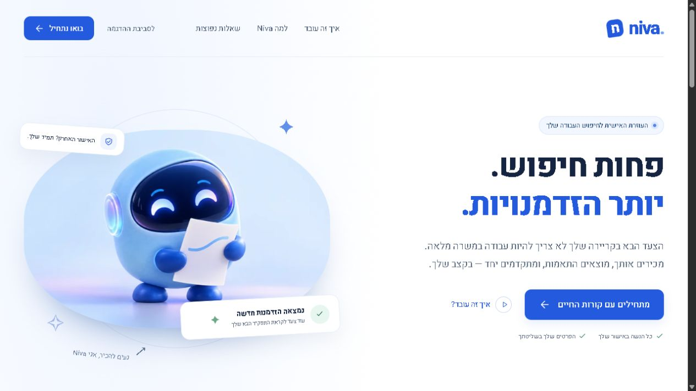

# Niva

A Hebrew-first job search pilot built with **Angular 22, TypeScript 6 and Tailwind CSS 4**. The hosted Worker uses verified Sites/ChatGPT identity and D1 for durable account data, with real employer listings, original application links and an approximate city map. A separate guest/demo catalog and the local Node/Better Auth server are retained. Google/Apple/email methods require their own configuration; they are not presented as working on the hosted pilot.

See the [pilot walkthrough, architecture, source accuracy and verification](docs/pilot.md). The earlier [account guide](docs/accounts-map.md) documents local SMTP/OAuth configuration and the original implementation milestone.



## Run locally

Use Node.js 24.15+ (24.x) and npm.

```sh
npm ci
npm run build
npm run preview
```

Open [127.0.0.1:4300](http://127.0.0.1:4300). The preview applies versioned migrations and serves Angular and the account API from one origin. To test email locally without sending real messages, set `NIVA_MAIL_MODE=local` before the preview command; see the [account guide](docs/accounts-map.md) for the local outbox and Angular development proxy setup.

```sh
npm run db:migrate
npm run api
```

The API command serves an existing build and database. Unconfigured Google, Apple and email methods remain visibly unavailable; there is no fake sign-in.

## Included

- Responsive Hebrew RTL landing page, original mascot, FAQ and local cookie preference controls.
- Three-step setup with optional local CV selection, preference selection and demo acknowledgement.
- Candidate dashboard, sample jobs, search, work-model filters and saved jobs.
- Job details and explicit demo approval, with duplicate, exclusion and pause checks.
- Local approval history, editable preferences, temporary profile details, JSON export and reset.
- Separate verified accounts with cookie sessions, durable account-owned preferences/profile/theme, explicit demo-data import and account-data deletion.
- Lazy Leaflet map with approximate demonstration cities, grouped markers, multiple offices, remote/missing-location sections and a usable list fallback.
- Lazy-loaded standalone components, Angular signals, strict templates and self-hosted fonts.
- Unit and browser journey tests, automated axe accessibility checks, desktop/mobile screenshots and GitHub Actions validation.

**Demo boundary:** all jobs and approvals remain demonstrations. The account API persists user choices; it does not connect CV upload/parsing, AI, live job feeds, employer communication or payments. Approving a sample job records a demonstration entry on the device or in the signed-in account. CV content is never read or uploaded. Guest names and selected filenames remain temporary; account name/headline fields are intentionally durable.

## Checks

```sh
npm test
npm run test:server
npm run typecheck:tests
npm run typecheck:server
npm run typecheck:e2e
npm run build
npx playwright install chromium
npm run test:e2e
npm run format:check
```

Browser tests run the production build at port 4300. Build first. They cover onboarding, filtering, saving, approval acknowledgement, deduplication, pause, file validation, reset, mobile overflow and automated accessibility. Automated checks do not replace manual screen-reader and production security testing.

## Project structure

```text
src/app/core/      Typed state, models, sample data, migrations and theme service
server/           Better Auth, session-owned account API and versioned SQLite migrations
src/app/shared/    Brand, icons, job cards, page headings and shared preference controls
src/app/pages/     Landing, setup, candidate workspace and information pages
public/assets/    Optimized original hero artwork
tests/            Desktop and mobile Playwright journeys
src/styles/       Shared theme tokens, base rules and contextual styles
scripts/          Production preview, build provenance and screenshot capture
docs/             Specification, design assets and implementation roadmap
```

## Documentation

- [Illustrated website specification](docs/website-specification.pdf)
- [Editable specification](docs/website-specification.md)
- [Implementation status and next milestones](docs/implementation.md)
- [Accounts, maps, database migrations and provider setup](docs/accounts-map.md)
- [Design tokens](docs/design/design-tokens.json)
- [Tailwind architecture and verification](docs/tailwind-refactor.md)

The production build is in `dist`. Hosting must rewrite application routes to `index.html`; see the implementation guide. The interactive demo is configured for private Sites hosting; the original GitHub repository is not a deployment target. This branch adds a Node/SQLite backend but has not been deployed. The existing static Sites configuration cannot run it; see the account guide for the required hosting decision. CV processing and employer integrations remain out of scope.

## Dependency note

The Vite override selects a patched 8.3.x release for the Angular development toolchain. The lockfile makes installs reproducible. Recheck the override when upgrading Angular. Third-party dependencies retain their own licenses; no open-source license for this repository is asserted.

## Reliability and accessibility repairs

See [implementation evidence](docs/repair-verification.md) for F01–F13 status, cross-tab consistency guarantees, reset failure semantics, screenshots and browser coverage. Persisted edits require Web Locks and available localStorage; unsupported environments fail closed for edits and approvals. To run Firefox and WebKit alongside Chromium, set CROSS_BROWSER=1 before the browser command.

## District preferences and appearance

Niva now includes 11 fictional jobs across nine professional fields and all six Israeli districts, shared multi-style checkboxes, and a persistent Light/Dark/System theme control. Older city and single-style preferences migrate without clearing demo records. See [behavior, migration and verification](docs/preferences-and-themes.md).
