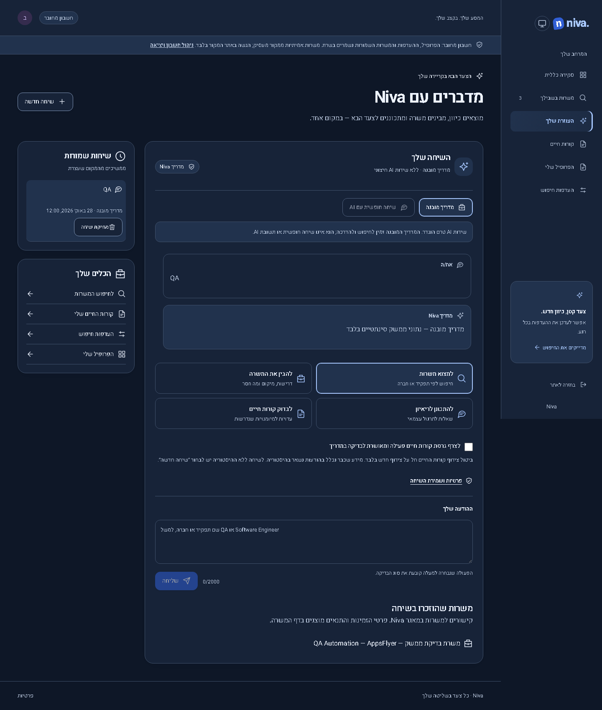
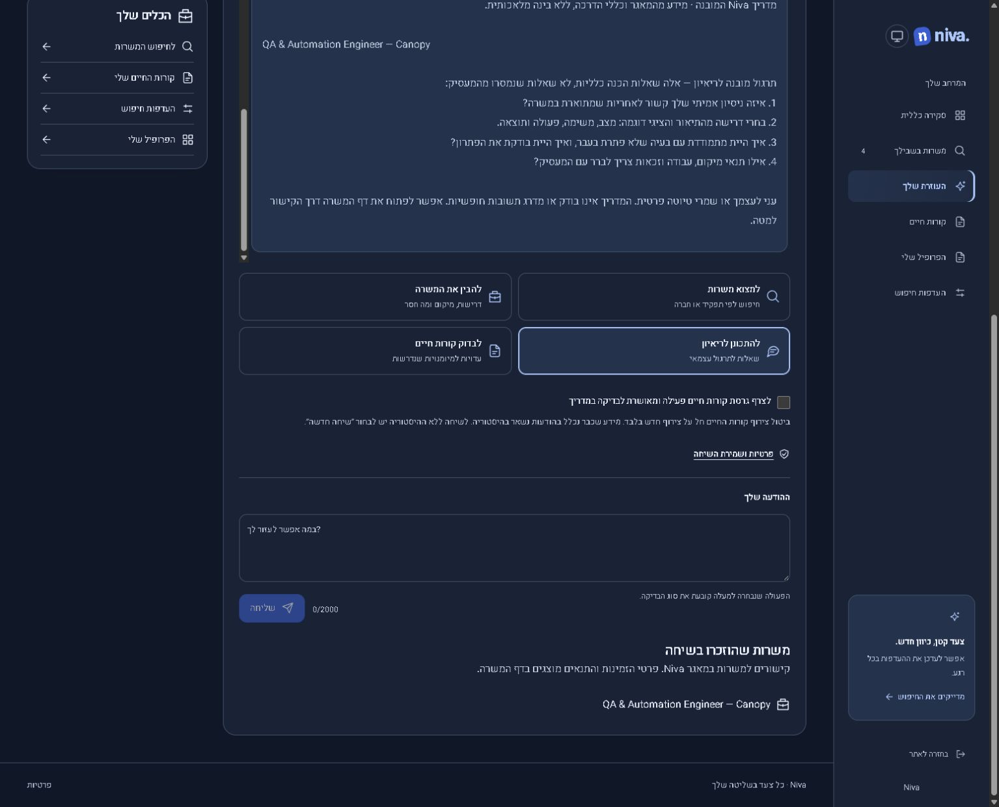

# Assistant repair — 28 October 2026

## Confirmed problem and scope

The authenticated live `/app/assistant` displayed “AI service not configured” and disabled Send on 28 October. The runtime variable inventory contained neither `OPENAI_API_KEY` nor `NIVA_AI_MODEL`. The existing backend correctly refused AI requests; the page nevertheless led users into a nonfunctional conversation form. No provider credentials were obtained or activated during this repair.

The new **built-in guide** provides actual catalog search, extracted requirements, opt-in résumé terminology evidence and fixed interview preparation. It is explicitly labelled **not AI**. It does not interpret arbitrary conversation, evaluate interview answers, generate résumé wording, or certify eligibility. Free-form AI remains unavailable until an operator securely configures an authorized provider project/model and performs real-provider evaluation. Mocked AI tests are not proof of real AI operation.

## Behavior and privacy

- Search uses the same `discoveryPage` implementation, saved preferences, confirmed candidate criteria and relevance ranking as the feed; no separate permissive recommendation engine or invented listings. It returns up to eight results, names the literal query and count, and explains empty-state recovery without silently relaxing preferences. A role/company query is a literal search, not natural-language filter extraction.
- Selected-job guidance uses the server-resolved listing and extracted facts. Missing/ambiguous requirements remain unknown. Country/residence, work authorization and citizenship conditions remain separate. Source availability is checked on the linked detail page; a search result is not asserted to be an open vacancy or an eligible application.
- Interview questions are identified as general preparation, not employer-supplied questions. Résumé comparison is terminology evidence only and requires explicit opt-in to an active, confirmed version. The guide does not transmit data to an AI provider.
- Guide conversations use existing authenticated, owner-scoped, 30-day career records and lifecycle guards. Existing AI conversations keep their mode. Cross-mode continuation returns a conflict; the UI starts a separate conversation on switching modes. Existing retention-operation verification limitations remain unchanged.
- Guide requests are bounded to 2,000 input characters, a 160-character literal search, ten exchanges/conversation, 20 conversations/account, 60 requests/account/day and 1,000 requests/site/day. AI limits remain unchanged. No application, employer contact or account/profile mutation tool is added.

## Interface

Task cards, consistent decorative SVG icons with text labels, a visible mode selector, job-context link, scrollable transcript, compact privacy details, loading/retry feedback, saved history and a native keyboard-accessible deletion dialog replace the oversized pre-chat disclaimer and empty panels. History failures do not turn a completed answer into a retryable generation failure. Non-JSON gateway failures show a recoverable message while preserving the draft. Job-context navigation preserves unsent text and invalidates old responses; explicit New conversation clears the draft.

## Actual visual evidence

The before screenshots were captured from the previous running production build before rebuilding. Before/after use the same synthetic fixture, question, mocked retry answer, dark theme and project viewport. These are real running UI screenshots, not generated mockups. The guide screenshots use explicitly labelled synthetic response text for repeatable visual/accessibility checks; separate server/full-stack tests exercise real guide generation. Historical screenshots remain untouched.

| View                          | Previous interface                                           | Updated interface                                          |
| ----------------------------- | ------------------------------------------------------------ | ---------------------------------------------------------- |
| Desktop, 1440 × 1000 viewport | [Before](screenshots/changes/assistant28/before-desktop.png) | [After](screenshots/changes/assistant28/after-desktop.png) |
| Mobile, iPhone 13 viewport    | [Before](screenshots/changes/assistant28/before-mobile.png)  | [After](screenshots/changes/assistant28/after-mobile.png)  |

[Mobile guide](screenshots/changes/assistant28/guide-mobile.png).

## Verification and availability

Frontend59 and server184 tests, three type checks, Worker/provenance checks and the production build passed. The broad Chromium desktop/mobile, Firefox and WebKit run exercised464 browser cases:459 passed and five failed. Four failures identified the résumé-history reminder hidden inside the new privacy details; it was restored as visible text. The fifth was a WebKit scan taken during route loading (missing heading/avatar label); it passed unchanged on retry. After the UI correction, all44 affected-area cases passed on the rebuilt application, including all five previously failing cases, both-theme axe checks, restored links, draft preservation, failure/retry/stop and real local account search → detail → guide → reload → delete. This is a broad run plus targeted repairs/retests, not a claim of one clean464-case run. A final literal-search-prefix repair was also verified in25 focused server tests, preserving company names such as Searchlight/Jobsity.

The build passes with one soft stylesheet-budget warning: assistant CSS5.58kB against a4kB warning threshold (8kB error threshold). The initial bundle remains under its configured warning threshold. No field performance measurement or real AI provider evaluation is claimed. The assistant repair **0.4.0 / Sites48** was published on28 October 2026. [Deployment and live verification receipt](verification/publication-20261028-v48.json). The later, separate preferences release **0.4.1 / Sites49** retains it. No data migration or external provider activation occurred. Existing job relevance, eligibility and layout repairs are preserved. Post-publication test/documentation updates do not create another deployment.

## Concurrent release integration

Before publication, GitHub and Sites were re-read. Remote releases0.3.3–0.3.5 / Sites45–47 had advanced while chat testing was underway. All were merged, including their source, tests, screenshots, histories and receipts. Only the additive0.4.0 version and chat release entry took precedence in the version/changelog conflicts. The combined-source build, frontend59, all three type checks and Worker runtime check passed. All76 affected browser cases passed across Chromium desktop/mobile, Firefox and WebKit, covering the new chat and all three concurrent layouts. The assistant history explicitly overrides the résumé-only grid row layout to preserve its sidebar reflow. No full broad suite was repeated after merging these UI-only releases; the unchanged server184 and focused25 results above retain their stated scope.

## Live verification after publication

The public build metadata matched reviewed GitHub `105de51a830151cac089dcd51016a79c89029d5b` and Sites `9237968fc424ad5b0b4b01e95176d27210d1596b`, with verified mapping and a clean source tree. Runtime revision7, public audience revision2 and the hourly source schedule were preserved.

- An authenticated guide search for `QA` returned four catalog listings under the account’s existing preferences: Canopy, Unframe, Veeva and Transmit Security. Four internal references were visible; opening Canopy reached its real job-detail route. A result is not asserted to establish vacancy availability or applicant eligibility.
- Saved QA history survived a full reload and reopened with linked records and change/status labels.
- Canopy requirements guidance returned extracted Manual QA/API evidence, two years of minimum experience, and explicit unknown eligibility/ambiguous-requirement wording. Interview preparation identified its questions as general exercises, not questions supplied by the employer.
- At390×844, the restrictive query `zzNivaGuideAuditNoSuchRole` returned a genuine empty state and recovery guidance. Returning to QA restored four results. Document width375 did not overflow the390 viewport. The desktop1550×1251 check had document width1535. The temporary viewport override was reset.
- Résumé sharing stayed unchecked. No personal résumé was processed for the live test, no profile/preferences/saves were edited, and no application or employer contact occurred. Two guide conversations and five guide exchanges were created and retained; production deletion was not performed. Résumé opt-in, deletion, stopping and provider-failure paths were verified only with local synthetic tests.

## Hosted CI result and test-only follow-up

[The deployed-source CI run](https://github.com/orKonijn/Niva-/actions/runs/40674315126) passed formatting, three type checks,59 frontend,184 server, Worker/provenance and build checks. Its browser stage finished **243 passed /3 failed**. One new guide test relied on a catalog left by prior local testing; two older account cases still used the country label changed by the matching-profile redesign. This is not reported as a clean CI run.

The guide test now seeds and removes only its own clearly synthetic, uniquely queried listing in an explicitly local `.test-data` database. It uses a supported route and the normal cached original-check path; no real employer vacancy verification is claimed by that fixture. No live application source is opened. The account cases use the current country label and the test’s selected base URL. **All four affected desktop/mobile cases passed in CI mode against a separately initialized local database on port4309**, after the fixture was corrected to satisfy normal route/URL validation. Those are test-only changes; the published runtime was unchanged. A replacement remote CI result is not claimed until observed.
