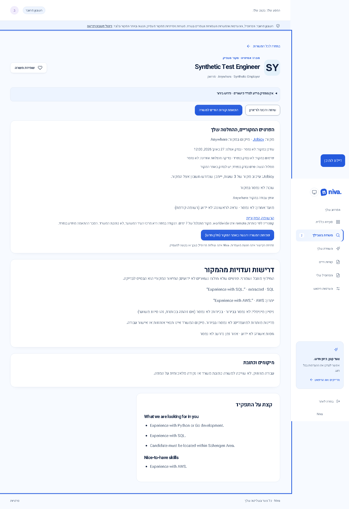
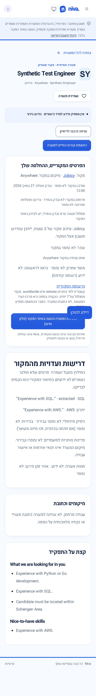
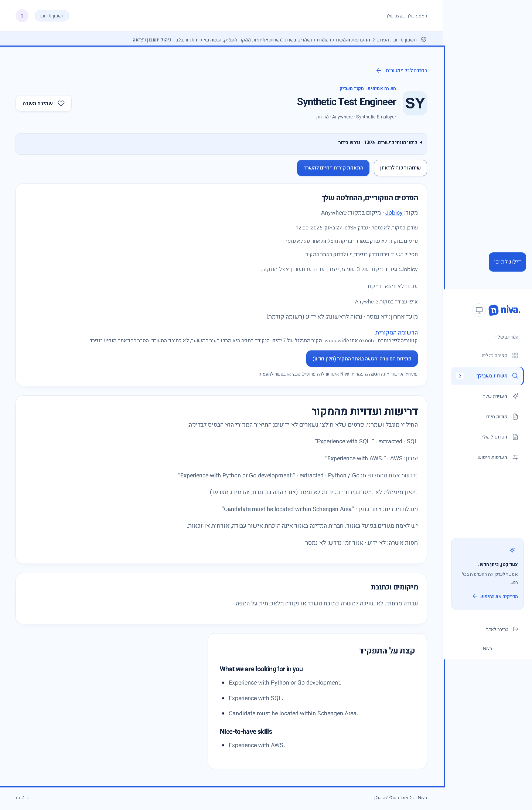
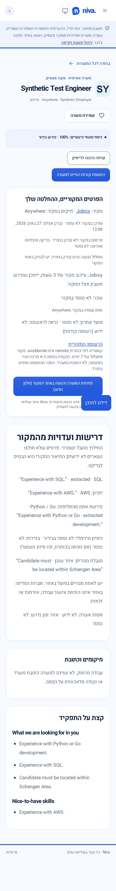

# Comparison audit repairs — 27 October 2026

Status: local Unreleased changes. Current package remains **0.3.1**; proposed next release **0.3.2** is a compatible patch. No commit, publication or production-data operation is part of this repair. Sites43 remains the latest recorded hosted release.

## Behavior and acceptance

| Finding                                    | Repair                                                                                                                                                                                                                                                                                  | Verification scope                                                                                                                                                                                    |
| ------------------------------------------ | --------------------------------------------------------------------------------------------------------------------------------------------------------------------------------------------------------------------------------------------------------------------------------------- | ----------------------------------------------------------------------------------------------------------------------------------------------------------------------------------------------------- |
| S01: Schengen residence ignored            | A source-quoted `applicantRegions` fact feeds the shared country predicate, server filtering before pagination, browser filtering, known-location counts, details and fit questions. Explicit incompatible residence blocks a confirmed profile; missing/unknown data stays unresolved. | IL/US/IE/CY conflicts; PT/BG/RO/NO country-level fit; negated, optional and client references do not become requirements. No citizenship or work authorization is inferred.                           |
| S03: required alternatives become optional | Preserve source block boundaries; recognize the observed headings; store a simple skill disjunction as one required group. Python or Go each satisfies the language group; SQL remains a separate requirement; AWS bonus does not affect coverage.                                      | Shared assessment and résumé coverage regressions, plus existing collaborator/example/bonus tests. Complex mixed alternatives remain unextracted; ambiguous inline section headings are flagged.      |
| B03: flattened cached Jobicy descriptions  | New ingestion keeps block text. Ordinary due trusted-original verification can recover only `jv-full-description` from an identity-matched JobPosting. Safe headings/lists render as text components.                                                                                   | In-memory Node and D1 contract adapters, exact identity/container checks, script/iframe exclusion, bounded body, no extra provider call and fresh-check cache reuse. This is not hosted D1 execution. |
| B05: clipped evidence                      | Word-boundary excerpts with ellipses, retained skill/experience anchor and a 300-character bound.                                                                                                                                                                                       | Long English/Hebrew clauses, combining marks and emoji.                                                                                                                                               |
| Freshness safeguard                        | Recovering descriptions or reaching an HTML page does not renew Jobicy's earlier provider-publication verification timestamp. Description evidence uses its own refresh timestamp.                                                                                                      | Both local adapter regressions. Reachability still does not establish a complete application form or an open vacancy.                                                                                 |

Additive optional fact fields need no SQL or account migration. The existing bounded public-cache reindex upgrades extraction version `source-sections-v5` on discovery. A rolling feed cannot restore missing historical HTML: older descriptions recover only after a successful ordinary source check, subject to the existing 15-minute cache/lease and quotas. Unsupported or changed source layouts retain the previous content and unresolved status; no fabricated headings are inserted.

Schengen membership is a reviewed country-level mapping, dated 2026-10-27, with the [EU Council source](https://www.consilium.europa.eu/en/policies/schengen-area/). It is a residence filter, not legal advice or proof of residence in an included territory. Actual residence and work eligibility always remain separate checks.

## Actual UI evidence

Both captures use the same synthetic response, light theme, 100% zoom and viewport. “Before” uses the prior compiled application UI; “after” uses this implementation. The comparison demonstrates rendering of the same response, not a historical claim about the old extractor's output. No private account or résumé data is included. Full-page screenshots retain context.

| Desktop (1440 × 1000)                                                                                                                                     | Mobile (390 × 664, iPhone 13 emulation)                                                                                                                                  |
| --------------------------------------------------------------------------------------------------------------------------------------------------------- | ------------------------------------------------------------------------------------------------------------------------------------------------------------------------ |
|                |                                 |
|  |  |

## Remaining limits

S02 requires an approved hosted operator, staging/production infrastructure and alert receiver. These repairs do not activate hosted maintenance, send alerts, run private retention cleanup or perform a restore. Hosted identities, scheduled deletion cadence, actual alert receipt and erasure-safe restoration remain unverified. Optional job tracking/product enhancements remain outside these required bug fixes. No employer was contacted and no application was submitted.

The [read-only public-source check](verification/comparison-source-check-20261027.json) recovered both audited Jobicy originals, retaining Canonical's Python/Go alternative and Side's Schengen residence restriction. This verifies the current source parser against those two pages; it does not prove open vacancies, application completion or deployment.

## Local validation

- Full repository checks: formatting; all three TypeScript checks; 59 frontend tests; 170 server tests; Worker runtime and provenance checks; production Angular/Worker build; 224 desktop/mobile browser tests (zero failures, skips or flaky results).
- After the final consistency adjustment to count residence regions and alternative groups in data completeness, the affected 38 server regressions, production build and two desktop/mobile UI tests were rerun successfully. The UI checks include WCAG A/AA scanning and horizontal-overflow detection. This automated scan is not a complete accessibility audit.
- Both updated screenshots were visually inspected. Historical screenshot files generated by older tests were restored to their pre-test bytes; only the new comparison evidence is retained.
- See the [local verification receipt](verification/comparison-repairs-20261027.json) for scope. Builds and local tests do not establish deployment or hosted behavior.
