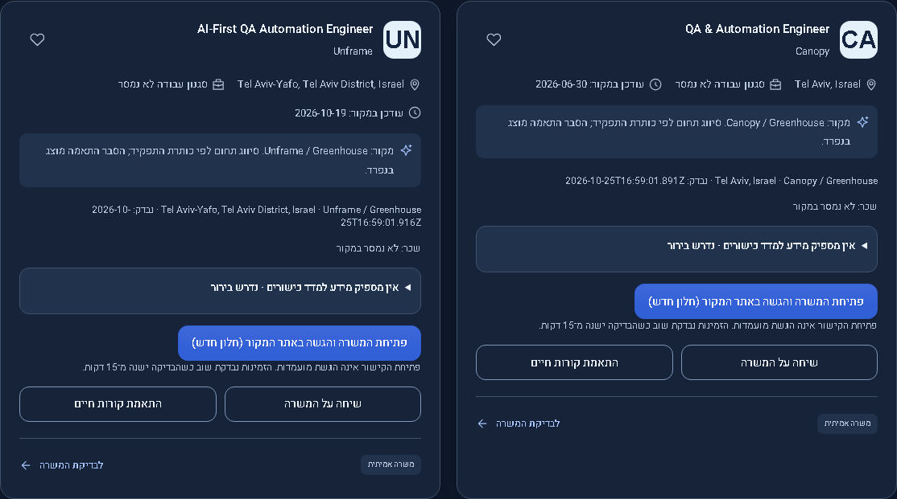
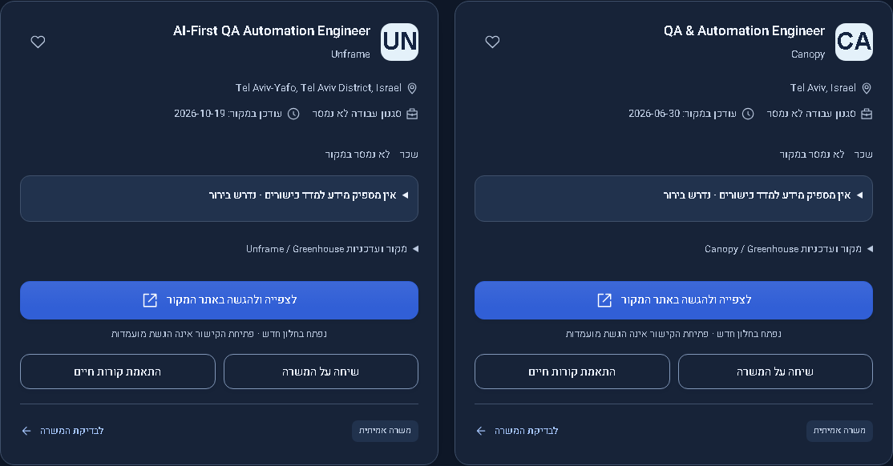
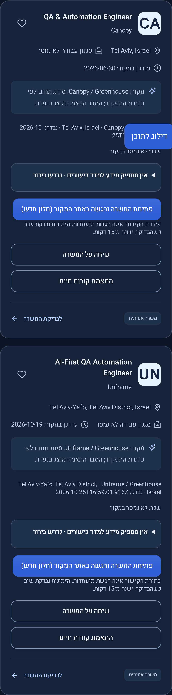
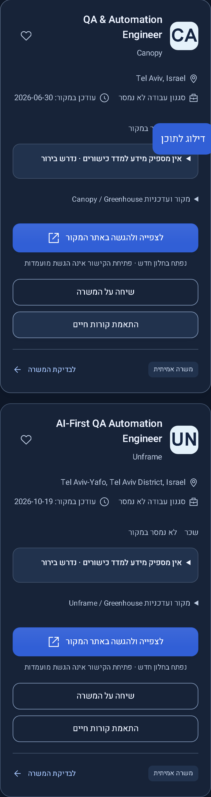

# Job card layout repair — 2026-10-28

Version 0.3.3 is a compatible presentation repair on the 0.3.2 source. Publication status is recorded separately from successful local checks.

The screenshot reported repeated provenance, dense small text, raw check timestamps and staggered action rows. Cards now separate title/company, location/work style, pay, skill evidence, source disclosure and actions. Source details remain keyboard-accessible through native details/summary controls; timestamps retain their original ISO values in datetime/title attributes. The source Apply path, new-window behavior, save control and job-specific assistant/resume links are retained. English locations use bidirectional isolation inside the Hebrew layout.

The captures below show the actual previous and current builds using the same public two-vacancy fixture and synthetic account. Fixture timestamps and unknown fields are historical evidence, not fresh employer checks. The existing narrow-card breakpoint stacks secondary buttons; desktop application buttons are aligned across the row.

## Desktop dark

## Mobile dark

Light-theme captures are retained in the same directory. Browser assertions check action alignment, overflow, expandable source and match information, original application paths and accessible link labels. No real profile writes or applications are needed for these checks. This visual repair does not establish new job relevance, score calibration or hosted operational readiness.

## Verification

The production build, frontend suite (59/59), browser-test type check and full Chromium browser suite (230/230 across desktop/mobile) passed. Formatting checks passed for the changed implementation, test and visual notes. The eight captures include both themes and both viewport sizes. Physical-device and additional browser-engine checks were not performed for this patch.

The old reviewed-source mapping referred to the earlier GitHub source and is removed instead of falsely attributing these edits to it. Build metadata and the Sites publication identify the changed source independently.
