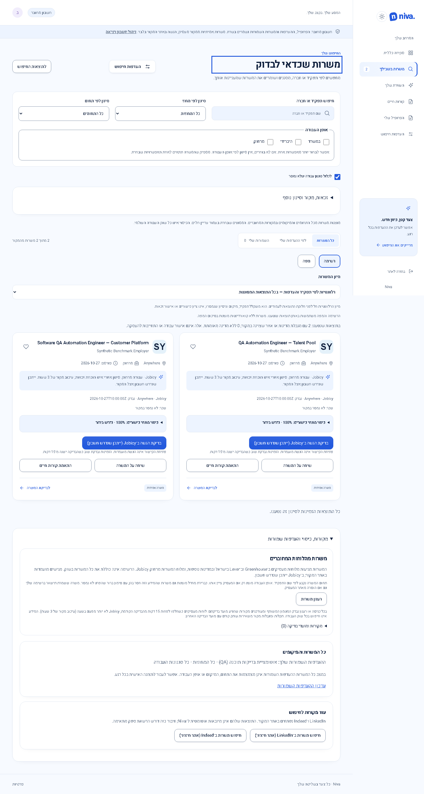
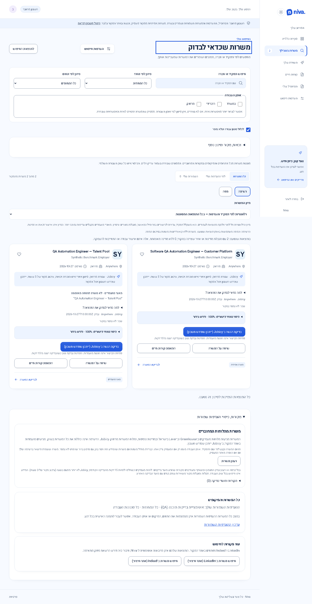

# Relevance and eligibility improvements — 27 October 2026

## Status and scope

Local Unreleased work, preserving the previous comparison repairs and unrelated files. Package remains **0.3.1**; the proposed next release is **0.3.2**, a compatible correction to existing discovery, source interpretation and explanations. No commit, push, deployment or production-account mutation was performed. Sites43 remains the latest recorded hosted release. No account or SQL migration is required. Optional public facts are additive; existing public-cache reindex upgrades extraction to `source-sections-v6`. Relevance cursors bind to `discovery-evidence-v2` and the confirmed criteria; old cursors must restart normally.

## Demonstrated fixes

| ID  | Reproduction and previous behavior                                                                                                                                                                          | Corrected behavior and acceptance                                                                                                                                                                                                                                                                        |
| --- | ----------------------------------------------------------------------------------------------------------------------------------------------------------------------------------------------------------- | -------------------------------------------------------------------------------------------------------------------------------------------------------------------------------------------------------------------------------------------------------------------------------------------------------- |
| R10 | Two QA automation roles with different required tools received the same rank for a confirmed Python/SQL seeker. ID order could determine the first page.                                                    | Positive confirmed skill evidence orders same-family leads. Alternatives count as one requirement; missing evidence is not disqualification. Unconfirmed profile data contributes no points. Frontend React/TypeScript cases provide a contrasting role check.                                           |
| R11 | A genuine Software QA Automation Engineer — Customer Platform lost 70 points because “customer” appeared anywhere in the title. Manufacturing QA/Food Safety QA also entered related software-QA expansion. | Occupational exclusions are narrower. Explicit non-software QA is excluded from related expansion; literal search still finds it. Explicit software titles retain precedence over domain words.                                                                                                          |
| E10 | “Candidates must be located in Italy or Israel” extracted only Italy, incorrectly excluding an Israel-based seeker.                                                                                         | Preserve the complete supported list; mixed/unknown lists and conflicting statements stay unresolved with source conditions visible. Schengen-or-Israel does not become Schengen-only. Office geography cannot override an unresolved explicit restriction.                                              |
| D10 | Explicit talent pools could be presented like current vacancies and tie with suitable jobs.                                                                                                                 | Clear source-quoted disclosure in cards/details and lower priority. A talent pool is not labelled a confirmed closed listing. Description-derived pool evidence survives the server's bounded ranking projection. Generic recruiting, negation and vacancy closure alone do not establish a talent pool. |

Primary files: `src/app/core/discovery-ranking.ts`, `src/app/core/job-opportunity.ts`, `server/residence-requirements.ts`, `server/job-facts.ts`, `server/discovery.ts`, `src/app/core/job-assessment.ts`, job-card and job-detail components. Previous S01/S03/B03/B05 repairs remain covered by their original tests.

## Benchmark and actual observations

The [frozen before](verification/relevance-benchmark-before-20261027.json) and [after](verification/relevance-benchmark-after-20261027.json) benchmark uses 32 synthetic cases, split into development and reserved wording/stack variants, and five scenarios per split: close role, alternate title, country, remote country and restrictive empty search. The reserved variants were frozen before changes; they are not an independent blind evaluation. This deliberately adversarial, tie-heavy set tests confirmed-skill ordering rather than market precision.

The synthetic seeker confirms five years of experience, Israel residence and work authorization, and Python, SQL, Playwright, TypeScript and React skills. These are test assumptions, not facts about the real account. No salary or sponsorship assumptions are made.

The synthetic country/remote scenarios reuse uniformly Israel-restricted remote fixtures: they test consistency, not geographic diversity. Mixed-country, mixed-region and unknown cases are separately exercised by E10 and the preserved Schengen regressions. Do not treat these ten scenario/split runs as ten independent market samples.

Frozen target: at least 4/5 skill-aligned QA leads in each nonempty scenario, zero explicit country conflicts, no invented empty-search results, and preservation of distinct results. Before: 0/5 skill-aligned QA leads in each tie-heavy top five. After: 5/5 in all eight nonempty scenario/split combinations. Both empty searches remain empty. Related expansion removes the two labelled non-software QA cases; ordinary discovery still retains all 16 distinct results per split. Node and SQLite-backed D1 contract tests check global order, totals, pagination without duplicates/omissions and cursor invalidation on changed criteria.

Reproduce current benchmark with `node --import tsx scripts/relevance-benchmark.mts <new-output-path>`. Output creation refuses to overwrite evidence. Fixtures and frozen labels live in `tests/relevance-benchmark-data.ts`; tests in `server/relevance-improvements.spec.ts`. Historical before/after files are observations, not commands for reconstructing the old implementation.

The [public-source check](verification/public-relevance-check-20261027.json) revisits 20 prior audited records programmatically against their original source/provider. Fourteen exact employer ATS records were confirmed published; six Jobicy publication states remain unknown. No confirmed removed listing was observed, but unknowns are not counted as open or as verified closed. Application-form accessibility was **not tested** in this programmatic check. It was not a new authenticated live journey.

Public-cohort top-five role-family relevance was **5/5 before and 5/5 after**, using the same current facts and original role-family labels. Ordering changed, but there is **no demonstrated gain in public-cohort role-family precision, personal qualification or successful applications**. This distinction prevents the synthetic gain from being presented as a real-market outcome.

## Performance and visuals

The [five public-snapshot scenarios](verification/public-relevance-scenarios-20261027.json) apply programmatic filters to the same20 current records, not live-catalog browser searches:

| Scenario                                    | Results | Provider-published | Publication unknown |
| ------------------------------------------- | ------: | -----------------: | ------------------: |
| Literal QA                                  |       7 |                  6 |                   1 |
| Related SDET title                          |       7 |                  6 |                   1 |
| Strict known Israel applicant eligibility   |       0 |                  0 |                   0 |
| Remote plus strict known Israel eligibility |       0 |                  0 |                   0 |
| Restrictive absent role                     |       0 |                  0 |                   0 |

Zero strict-country results reflects insufficient explicit applicant-country evidence, not proof that no employer could hire the seeker. Office geography, residence, relocation and authorization are different questions. Unknown evidence is not upgraded to fill an empty search. This is a material remaining obstacle to verified actionable results.

An [additional current Side source check](verification/relevance-talent-pool-source-20261027.json), outside the paired20, confirms explicit “building a talent pool for future opportunities” wording and the Schengen condition. Vacancy publication and application accessibility remain unknown.

[Local latency measurement](verification/relevance-performance-20261027.json): Node24 on Windows, in-memory SQLite, 3,000 synthetic rows, five alternating-order samples per implementation with explicit garbage collection, page size12 and identical current facts. Median previous discovery latency was approximately128.4ms; new latency approximately137.8ms (+9.5ms, about7.4%). Extra evidence ordering adds work; these measurements are not hosted D1 latency or browser/field Web Vitals. Result count remained3,000 and returned page size12. The scan remains bounded to128 intermediate rows.

Actual synthetic UI, light theme, matching viewports and 100% zoom. Before uses the previous compiled implementation. The after screen shows the suitable customer-platform role first and explicitly labels the pool. Historical assets are preserved.

| Desktop 1440 × 1000                                                                                                                          | Mobile 390 × 664                                                                                   |
| -------------------------------------------------------------------------------------------------------------------------------------------- | -------------------------------------------------------------------------------------------------- |
|  |                 |
|                                          |  |

## Verification and release gates

Readable after-only details: [desktop pool](screenshots/changes/relevance/desktop-pool-detail.png), [mobile lead with reasons](screenshots/changes/relevance/mobile-lead-detail.png), [desktop lead](screenshots/changes/relevance/desktop-lead-detail.png), [mobile pool](screenshots/changes/relevance/mobile-pool-detail.png). These are actual element screenshots, not edited mockups. Desktop pool and mobile lead details were visually inspected.

Complete local suite passed: formatting, all three TypeScript checks, **59 frontend tests,177 server tests,1 Worker runtime test,1 provenance test, production build and226 desktop/mobile browser tests**, with zero failures/skips/flaky browser outcomes. After adding readable detail captures, the two affected browser cases passed again. See the [verification receipt](verification/relevance-improvements-20261027.json). Historical screenshot bytes were restored after the suite, retaining new relevance evidence. Automated WCAG scans and keyboard/browser regressions do not establish full accessibility conformance. No screen-reader speech or field Core Web Vitals result is claimed.

Existing main-journey tests cover setup, uploads/parser failures, confirmed profile state, saves, navigation recovery, empty/error states, handoff and account isolation in local fixtures. Local retention/restore/maintenance tests remain simulations. Hosted maintenance cadence, approved alert delivery, independent hosted identities and erasure-safe hosted restore still require the existing staging/operator/receiver gates. No production cleanup, alerts or applications were triggered.

An additional [actual local-backend journey](verification/relevance-local-journey-20261027.json) passed using the existing explicitly disposable loopback accounts, without mocked identity/account/résumé/state routes: PDF and DOCX first-time onboarding, review before persistence, preference reload, independent sign-in, save/unsave/reload, cross-owner export denial and303 original-source handoff. The external application request was deliberately not followed. Existing test accounts were reset by the approved local harness; no production identity/profile was used. The temporary server was stopped afterward.

The [local retention/restore drill](verification/relevance-local-retention-20261027.json) also passed: two actual timer deliveries at accelerated1.1-second cadence, expired-read denial, physical deletion, active-pointer clearing, a separate SQLite restore target, owner isolation, no restored expired probe and injected failure detection. Alert delivery remained disabled. This does not establish hosted scheduling, delivery of a real alert or replay of all production erasure obligations during hosted restore.

Release steps: review the complete working tree; run the normal source-reviewed staging/deployment process only after authorization; allow bounded public reindex, verify source parsing and pagination, record build identity, then repeat the five live search scenarios and at least20 results/10 originals on the deployed version. For rollback, restore the prior reviewed application and let its extraction reindex recompute public facts; optional fields require no private-data rollback. Do not rollback erased private data from backups.

This work improves demonstrated discovery failures; it does **not** justify a10/10 score. The unresolved evidence is real-world usefulness/actionability, full accessibility/field performance and hosted operational safety. Optional hide/undo and application-stage tracking are deferred until the required job-finding and operational gates are satisfied.
