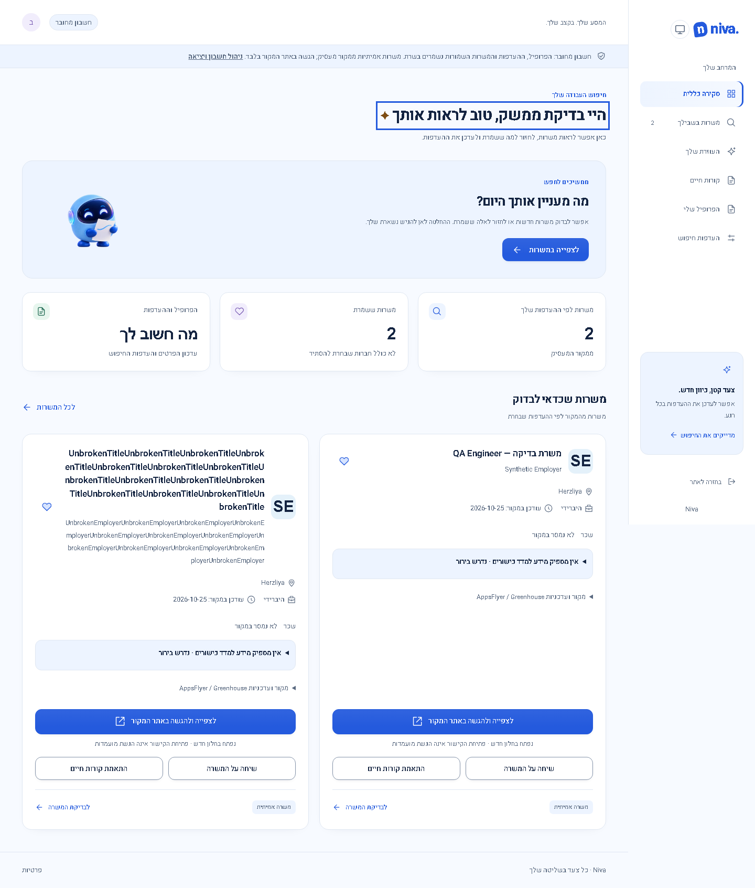

# Review repairs — 29 October 2026

Application **0.4.6 / Sites54**, published 29 October 2026, based on 0.4.5 / Sites53. [Publication and live receipt](verification/publication-20261029-v54.json). No production profile or résumé changes, employer uploads or submissions were performed in this repair task.

## Findings and repairs

- **B01 (confirmed):** comma splitting discarded manual-testing evidence from an explicit coordinated list. A synthetic reproduction failed before the fix. The matcher now retains recognized testing lists within their original clause, including preceding negation. Ordinary manual operations, disconnected testing, uncertain and negated lists remain unknown. Original evidence text is retained; terminology coverage never certifies qualifications or work authorization. Matching method is `evidence-v6`.
- **B02 (confirmed):** the preferences dashboard tile navigated to `/app/jobs`, selecting All. Desktop/mobile regression tests reproduced the wrong destination before the fix. It now opens `/app/jobs?scope=personal`. The dashboard explicitly requests that personal feed, reacts to loaded preferences/criteria and shows the server total, with loading/error placeholders. A paginated synthetic feed tests 23 total against 2 loaded records. The earlier live count discrepancy alone did not prove its specific cause; pagination and query/readiness are now covered locally.
- **B03 (confirmed):** fixed-offset work-arrangement excerpts began inside a word. Extraction now preserves whole edge words and marks omitted context. A synthetic source test verifies exact substring boundaries; fact version `source-sections-v7` ensures stored facts can be reindexed through the existing lifecycle.
- **S01 (confirmed locally before repair):** Saved→All and work-style toggles within one event loop lost selections because each router call merged against the previous committed URL. A real browser regression reproduced `saved=true&unknownStyle=false` with missing styles. Pending changes are now merged together; settled URL, selected controls and reload state must agree. This deliberately accelerated local reproduction is stronger timing than normal manual clicking.
- **Existing navigation recovery preserved:** browser module failures offer a local destination reload or dismissal without automatic reload or draft loss. Simulated failed chunk requests exercise profile/preferences navigation, draft preservation, recovery and return to résumés. Mobile tests open the drawer before selecting links.

## Actual synthetic UI evidence

Same synthetic account, light theme, viewport and running application for each before/after pair. Before captures used the old built implementation and reproduced the incorrect destination. The tile's appearance is nearly identical; its URL/feed behavior is the material change. No actual CV or account identifiers are included.

## Validation and release status

- Production build passed. The existing assistant stylesheet exceeds its warning budget (5.58 kB against 4 kB); it remains below the blocking budget and was not rewritten.
- 66 frontend and 186 server tests passed; all three TypeScript checks, formatting, Worker runtime and provenance tests passed.
- Full Chromium desktop/mobile run: 286 passed and 2 desktop local-email login waits exceeded the existing 5-second assertion. Both failed journeys passed individually without code/assertion changes (2/2); the same mobile journeys passed in the full run. This is recorded as timing variability, not an established production defect.
- All 10 focused Firefox/WebKit checks passed for personalized navigation, paginated totals, rapid filter persistence and failed-module recovery. Mobile uses browser emulation, not physical hardware.
- A cached-fact regression first reproduced duplicate old/new excerpts. The repair replaces extracted description snippets while preserving provider metadata/conflicting arrangement values; repeated enrichment is idempotent. The final full server run includes this test.
- Historical screenshot assets generated by broader tests were restored; only new review29 captures are included. Desktop/mobile after images were visually inspected.

## Publication and live verification

Native publication succeeded at 14:28 UTC on 29 October. Custom-domain HTML and build metadata match reviewed GitHub source `9bb83b8` and clean Sites source `8717d3e`; the content mapping was verified. Public audience revision2, environment revision7, existing bindings and refresh schedules were preserved. Publication documentation is Git-only and does not trigger another deployment.

In the authenticated live desktop browser, the dashboard tile showed4 personal results and opened `/app/jobs?scope=personal` with Personal selected and4 results. Canopy now shows100% terminology coverage against the same active résumé (previously50%); eligibility remains explicitly unresolved. Job details show “ … across teams …” rather than starting midword, and résumé→profile→preferences navigation succeeded without editing fields. No horizontal overflow appeared on the personal results page.

Actual live screenshot, cropped to remove the account header and avatar. No private résumé evidence is expanded. This proves terminology recognition, not complete qualification or eligibility.

The existing in-app tab initially retained the old asset after reload; a fresh tab loaded the published release. Open a fresh tab if an older session still shows the previous behavior. Live phone hardware, external employer forms, full provider freshness and new application submissions were not retested. Remaining source-coverage/freshness uncertainty and employer upload restrictions from the review are not represented as repaired. No new overall product score is claimed from this focused repair.
