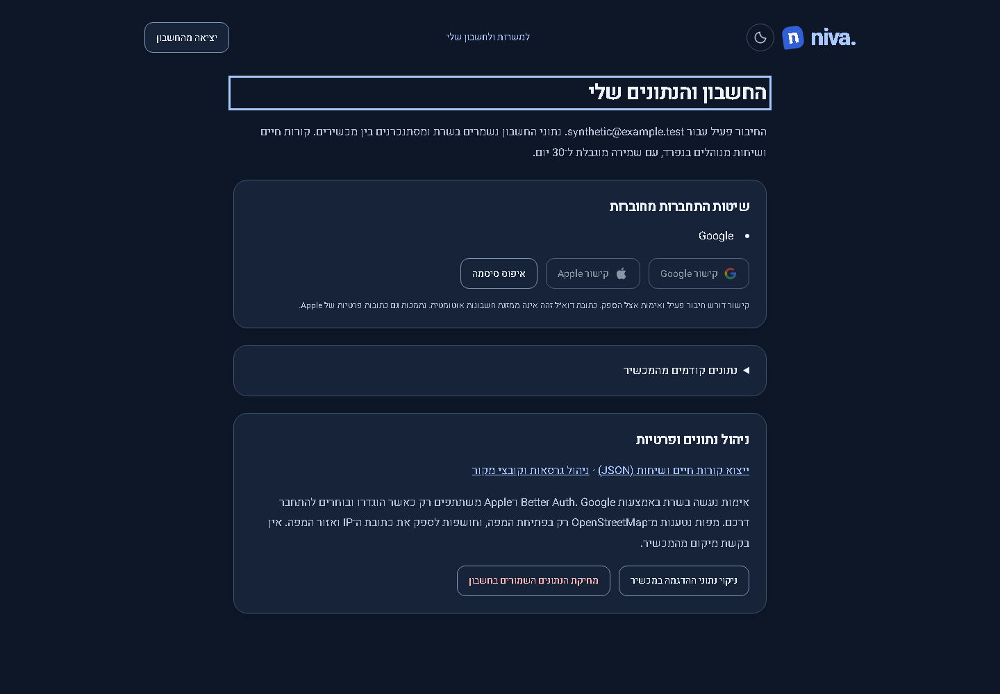
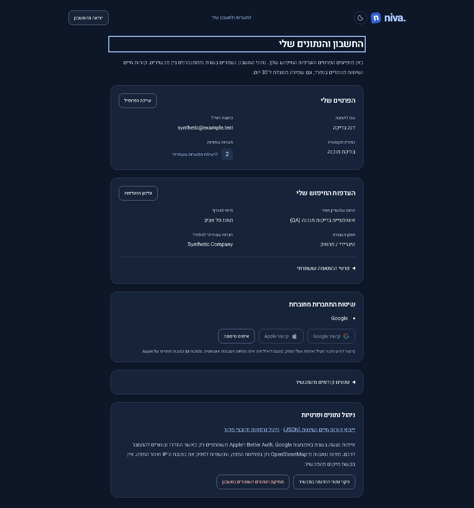
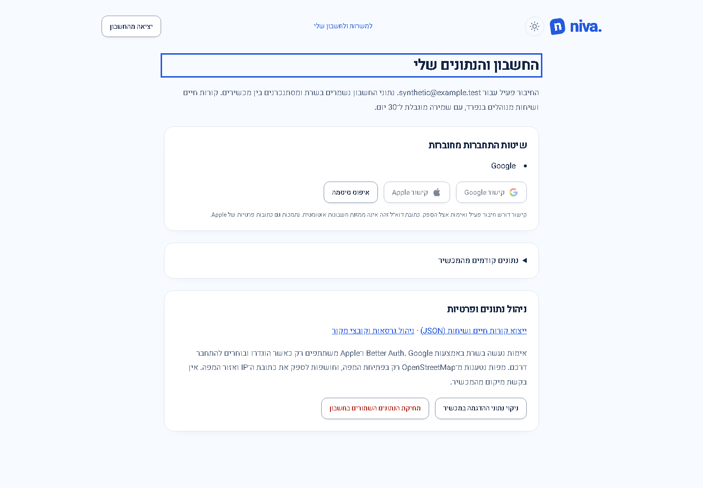
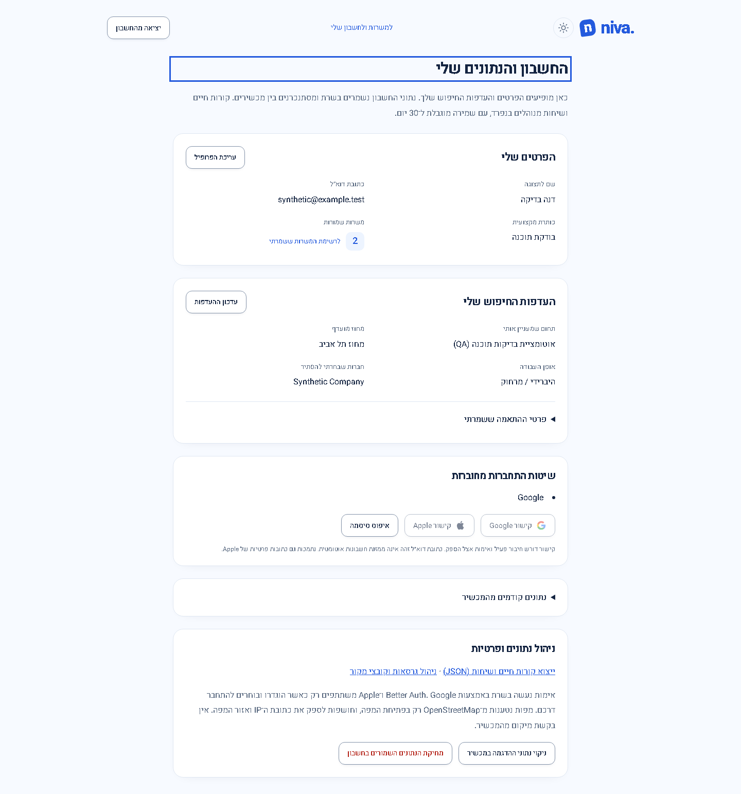

# Account data overview

Published application **0.4.5 / Sites53**, 2026-10-28. [Publication/live receipt](../../verification/publication-20261028-v53.json). Previous published release:0.4.4 / Sites52, whose résumé validation repair is preserved. Compatible account presentation fix; no schema, API, provider, permission or migration change.

The account page now shows the active user's display name, email, professional headline, saved-job count and saved search preferences. Edit links lead to the existing profile/preferences pages and saved-job view. An expandable section presents the saved matching criteria with Hebrew labels. Empty fields remain clearly missing, authorization/citizenship unknowns remain unknown, and zero years/salary remain zero. The display name uses the saved profile name, falling back to the authenticated name when no profile name is available. It does not infer attributes from a résumé or provider identity.

Saved profile/preferences/counts appear only after account data is ready. The existing store clears them when the active identity changes; the methods list now reloads per owner and discards responses from older owners. Failed reads show the existing error feedback without presenting unloaded counts as zero. Rendering this page performs no save/import/delete operation. Account guard, existing export/import/deletion actions and retention behavior are unchanged.

Actual running `/account` screenshots use the same synthetic identity, saved profile/preferences, two saved job IDs, viewport, theme, zoom and data. Desktop viewport1440 ×1000; mobile390 ×664 at scale factor3. These are full-page captures with matching criteria collapsed. Before shows the old email-only introduction and management panels; after adds the saved data summary above them. No live user data is tracked in these images.

| View          | Before                                                                                                                      | After                                                                                                                          |
| ------------- | --------------------------------------------------------------------------------------------------------------------------- | ------------------------------------------------------------------------------------------------------------------------------ |
| Desktop dark  |  |  |
| Desktop light |            |                            |
| Mobile dark   |                             |              |
| Mobile light  |                                   |                       |

Product files: `src/app/pages/account.ts`, `account.html`, scoped `account.css`. The new `tests/account-overview.spec.ts` checks real fixture values, zero values, unknowns, empty data, delayed/failing reads, account switching, refreshed provider lists, no rendering writes, both themes, narrow-screen overflow and accessibility. Before images were captured on0.4.3; the concurrent0.4.4 résumé repair did not change this account page.

Review and verification: no blocking findings in data ownership/readiness, name fallback, preserved zero/unknown values, text escaping/bidi handling or read-only rendering. Production build, both frontend-test/browser-test TypeScript checks,59 frontend unit tests and all54 browser checks across account overview, real local account journeys, hosted-auth boundary fixtures and résumé-save integration passed. The first broader run used a runner mailbox/data directory different from its preview and had10 registration/email-related failures; the preview and runner were aligned to the same isolated local origin/data directory, then the full54 passed. No product workaround or weakened assertion was used. Changed files passed formatting and whitespace checks; historical résumé screenshots produced by tests were restored. Mobile uses browser emulation. Hosted deletion/retention and real external OAuth were not reassessed. The existing assistant stylesheet budget warning is unchanged.

Live verification: custom-domain build metadata matches reviewed GitHub source `f3cd2a4` and Sites source `5176829`. The authenticated account page shows two summary cards, four identity/profile/count fields, four preference fields, expandable matching details and no horizontal overflow. Presence/structure were recorded without copying the user's actual field values. No live account/profile/preferences/file data were created, edited or deleted. Synthetic comparison images are tracked; the private live preview stays local.
