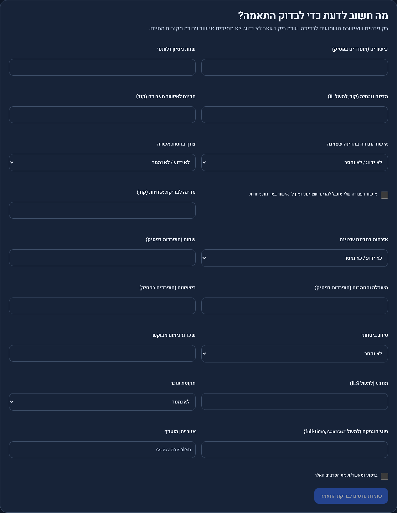
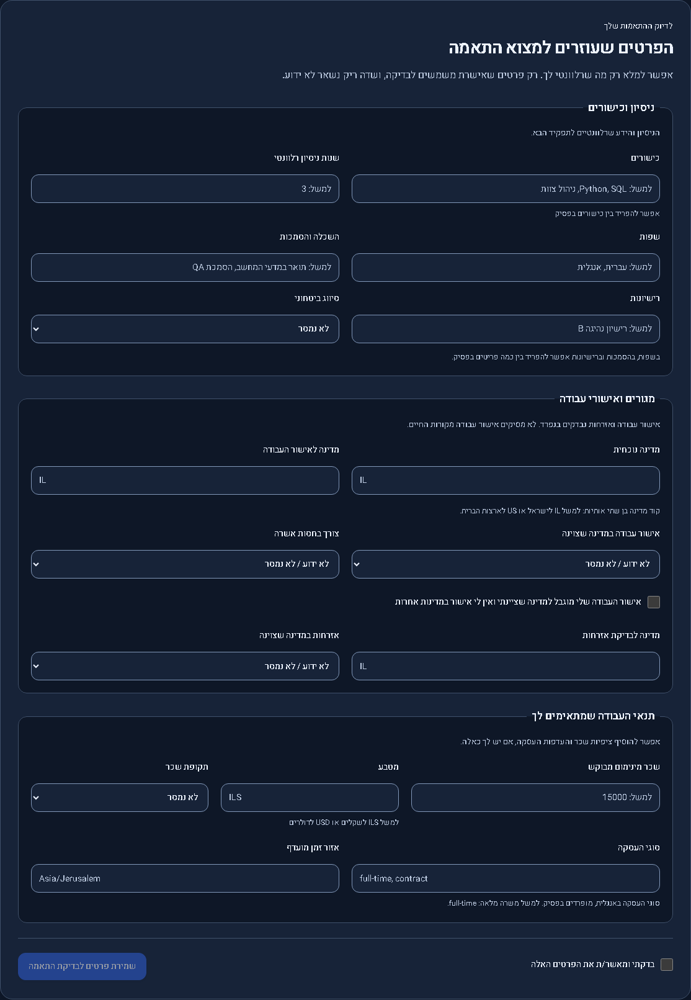
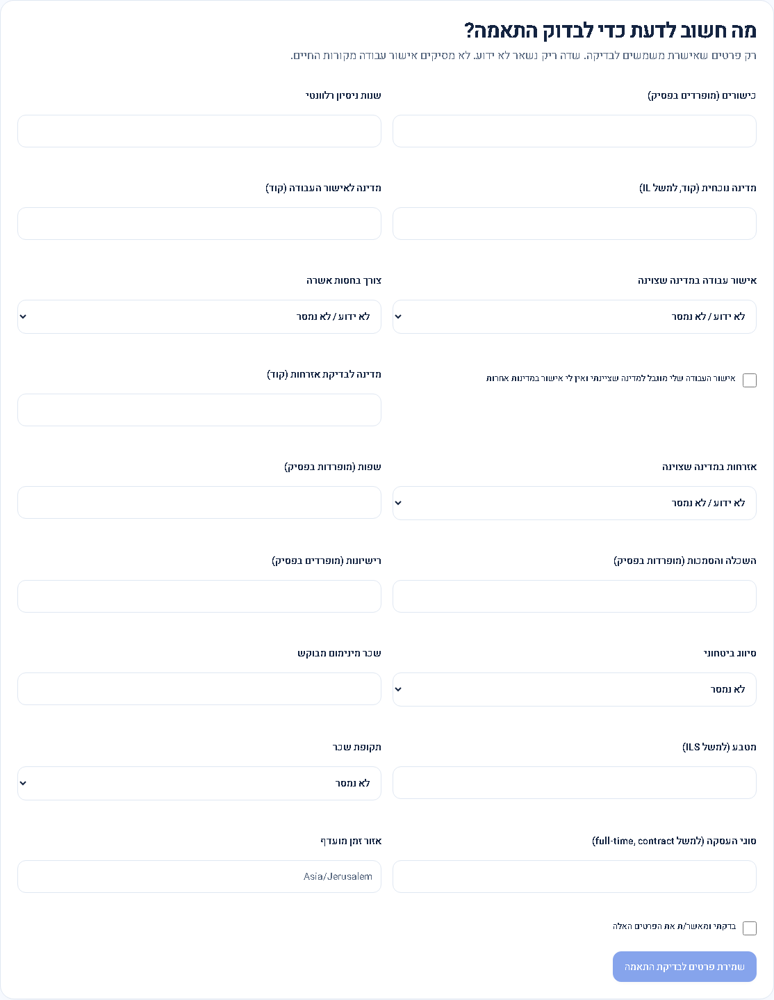
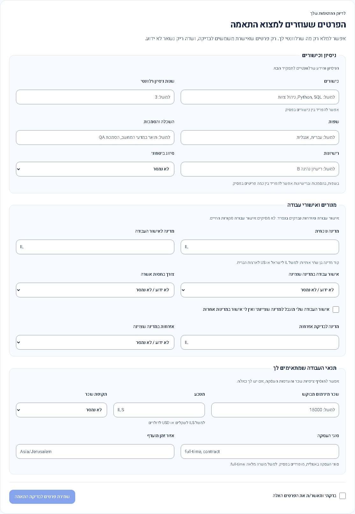
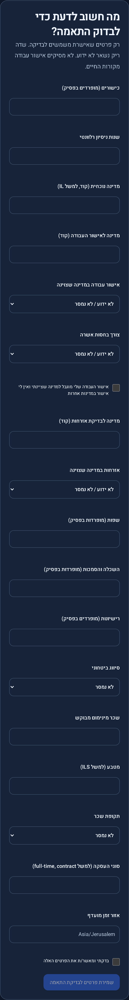
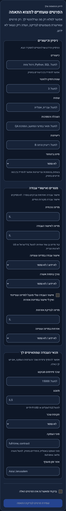
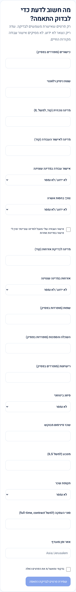
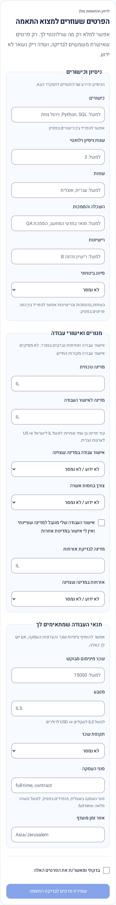

# Candidate profile form layout

Published application **0.3.5 / Sites47**, 2026-10-28. [Publication/live receipt](../../verification/publication-20261028-v47.json). Previous published version:0.3.4 / Sites46. This is a compatible presentation repair. No account-data, API or configuration change; no migration required.

The previous matching-profile form placed every field in a single undifferentiated grid with large repeated field margins. The repair groups all 17 fields into three labelled fieldsets: experience/skills, residence/work permissions and work preferences. Scoped spacing, clearer input backgrounds, Hebrew helper text and a separate confirmation/save footer improve scanning. Country, currency, employment-type and timezone codes stay left-to-right; existing values and normalization are preserved. All fields remain visible and editable, and unknown work authorization/citizenship remain explicit.

These actual running `/app/profile` component captures use the same empty synthetic account, theme, viewport, zoom and data. Only the candidate component is captured. The mobile screenshot width is the component width within a 390px viewport, at device scale factor 3.

| View                              | Before                                                                                                      | After                                                                                                                                       |
| --------------------------------- | ----------------------------------------------------------------------------------------------------------- | ------------------------------------------------------------------------------------------------------------------------------------------- |
| Desktop dark,1440 ×1000 viewport  |                   |  |
| Desktop light,1440 ×1000 viewport |  |           |
| Mobile dark,390 ×664 viewport     |       |                          |
| Mobile light,390 ×664 viewport    |     |               |

Product changes are limited to `src/app/shared/candidate-profile.ts` and its new template/style files. The save implementation is unchanged. `tests/candidate-layout.spec.ts` verifies all 17 controls, three semantic groups, light/dark layout, overflow at 320/700/768/1440px, accessibility, confirmation gating, unchanged unknown authorization/citizenship, synthetic save payload normalization and retained values after reload. No private profile writes are used for these tests.

Review and verification: no blocking product finding in the template bindings, scoped styles, RTL code fields, labels/descriptions, unknown defaults or save-confirmation gating. The initial focused test used an exact implicit-select label that included its options; querying the accessible combobox name fixed that test locator. Production build, both frontend-test/browser-test TypeScript checks, 59 frontend unit tests and 44 Chromium browser checks across the candidate layout, discovery profile and existing UI review suites passed. Changed files passed formatting and whitespace checks. Historical captures produced by existing tests are restored. Physical devices, other browser engines and backend/hosted operational guarantees were not reassessed.

Live verification: custom-domain build metadata matches the reviewed GitHub and Sites sources. Chrome shows the three labelled groups, all 17 editable fields, both checkboxes, compact field margins, no horizontal overflow and a disabled save action before confirmation. No live profile edits, uploads or deletions were performed. Only synthetic screenshots are tracked; the live user preview remains local.
