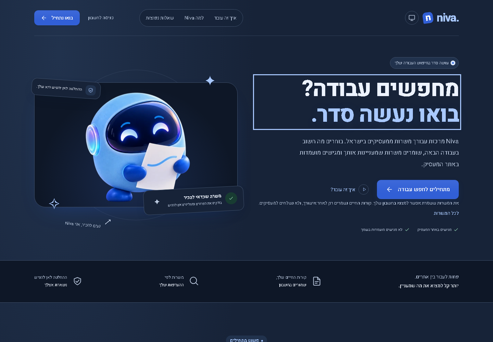
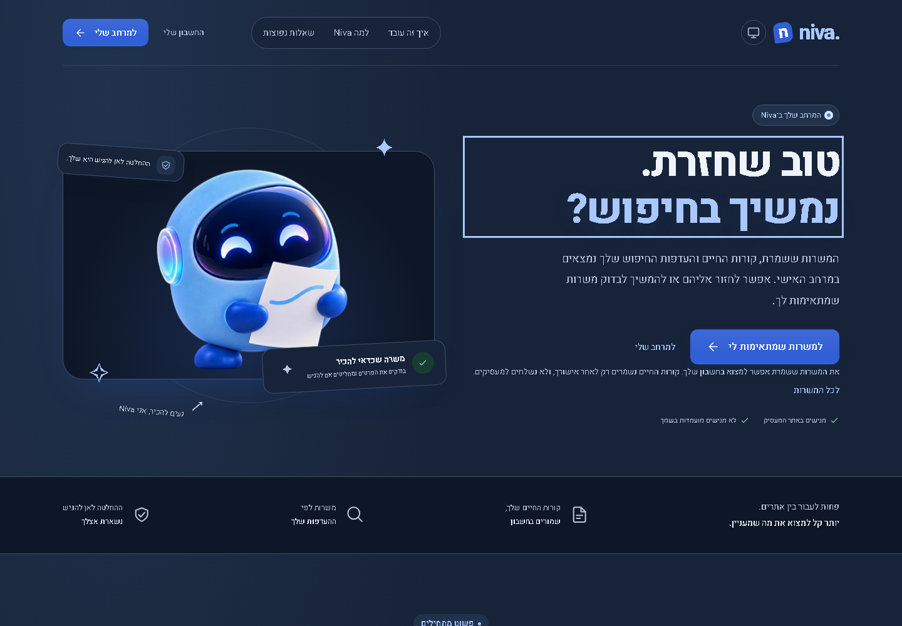
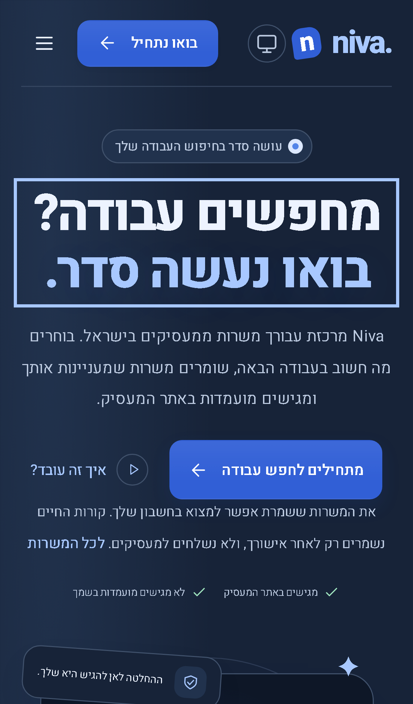
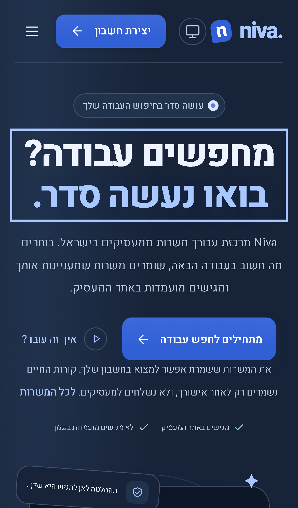
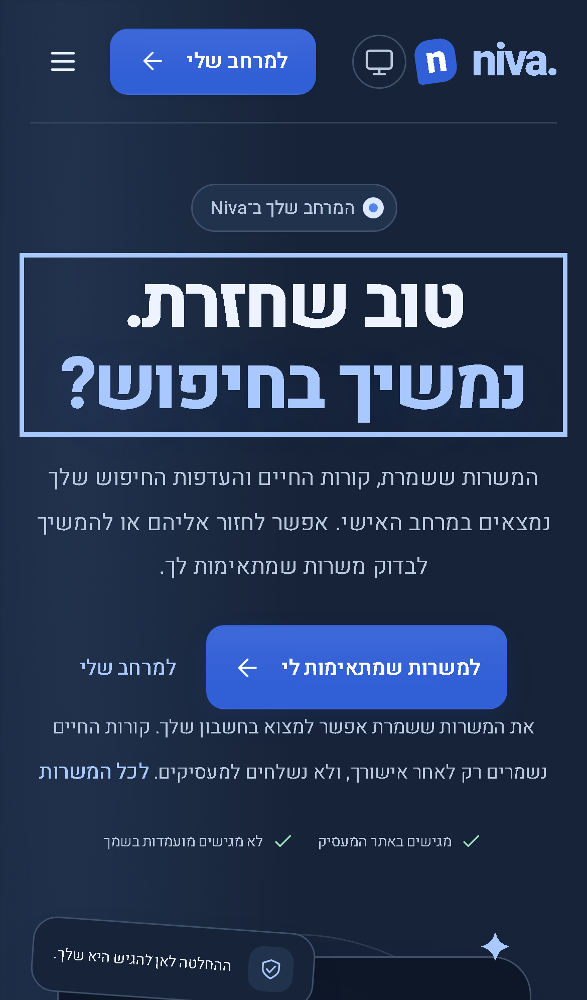

# Homepage for visitors and signed-in members

Published application **0.4.3 / Sites51**, 2026-10-28. [Publication/live receipt](../../verification/publication-20261028-v51.json). Previous published release:0.4.2 / Sites50. Compatible navigation/presentation repair; no account, API, permission, schema or provider-configuration change.

The homepage previously displayed the same login/start prompts even with a verified session. It now reads the existing account-session signal:

| State                 | Header                     | Hero                                                   | Final action          |
| --------------------- | -------------------------- | ------------------------------------------------------ | --------------------- |
| Visitor               | Login and account creation | Original introduction and start action                 | Start finding jobs    |
| Signed in             | Account and workspace      | Welcome back, personal jobs and workspace links        | Return to workspace   |
| Initial session check | Neutral pending state      | One accessible pending message, no signup/login action | Neutral pending state |

The mobile menu exposes login for visitors and account management for members. Verified session changes update the page without a reload. A member with incomplete setup still follows the existing guard into setup; no login, verification or setup restriction is bypassed. Sites uses its existing unified `/login` provider entry for new/returning visitors; standard accounts use `/register`, while the account-disabled demo keeps `/signup`. No account is created merely by visiting or clicking a homepage action. Names, emails and account contents are not rendered into the marketing page.

Actual running homepage before/after captures use matching synthetic session/account data, viewport, theme, zoom and scroll position. Desktop viewport1440 ×1000; mobile390 ×664 at scale factor3. Before screenshots show the original identical visitor copy in both states. After screenshots show the actual conditional implementation.

| View                    | Before                                                                                                       | After                                                                                                           |
| ----------------------- | ------------------------------------------------------------------------------------------------------------ | --------------------------------------------------------------------------------------------------------------- |
| Visitor, desktop dark   |                          |       |
| Signed in, desktop dark |  |  |
| Visitor, mobile dark    |                        |                           |
| Signed in, mobile dark  |  |                  |

Matching light-theme pairs: [visitor desktop before](home-session-visitor-desktop-light/before.png) / [after](home-session-visitor-desktop-light/after.png), [member desktop before](home-session-member-desktop-light/before.png) / [after](home-session-member-desktop-light/after.png), [visitor mobile before](home-session-visitor-mobile-light/before.png) / [after](home-session-visitor-mobile-light/after.png), [member mobile before](home-session-member-mobile-light/before.png) / [after](home-session-member-mobile-light/after.png).

Product files: `src/app/pages/home.ts`, `home.html`, and scoped `home.css`. Session/auth/store/route-guard implementations are unchanged. `tests/home-session.spec.ts` covers both states/themes/viewports, mobile navigation, overflow at320/390/768/900/1440px, accessibility, delayed session initialization, cross-tab logout/login refresh, setup routing and standard-account registration. The pilot homepage assertion now expects the member jobs action when its fixture is signed in.

Review and verification: no blocking findings in session gating, provider-aware destinations, signed-out fallback, mobile link visibility or setup-guard preservation. Production build, both frontend-test/browser-test TypeScript checks,59 frontend unit tests and50 Chromium browser checks across homepage session states, pilot authentication, existing journeys and UI/motion checks passed. Changed files passed formatting and whitespace checks. Mobile uses browser emulation; physical devices and additional browser engines were not reassessed. The existing assistant stylesheet budget warning is unchanged.

Live verification: custom-domain build metadata matches reviewed GitHub source `c02e388` and Sites source `d31370d`. The existing signed-in homepage now shows the welcome-back message, header links to account/workspace, hero links to jobs/workspace, and a workspace final CTA with no signup/login prompts or horizontal overflow. Visitor behavior is covered by the synthetic browser sessions; the live user was not signed out. No account, profile or preference data were created or changed. Only synthetic comparison screenshots are tracked; the live preview stays local.
