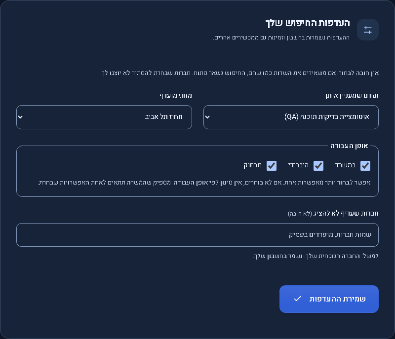
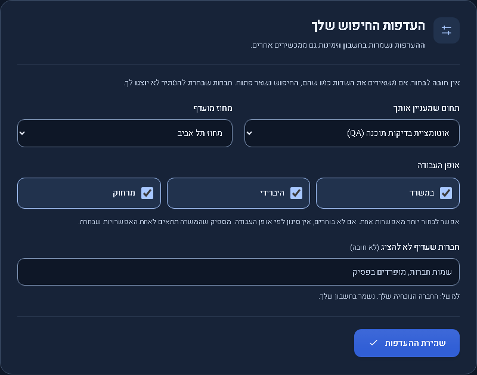
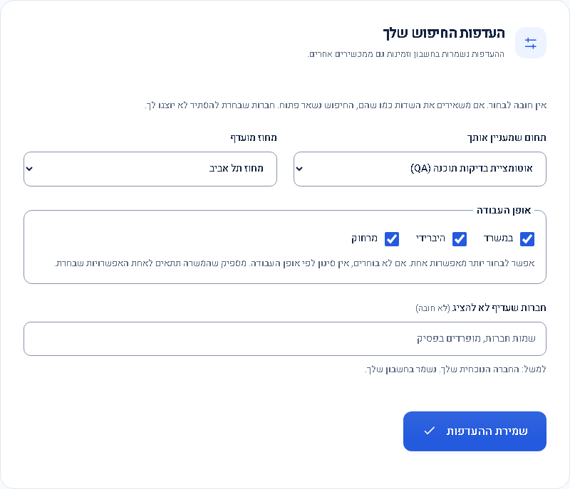
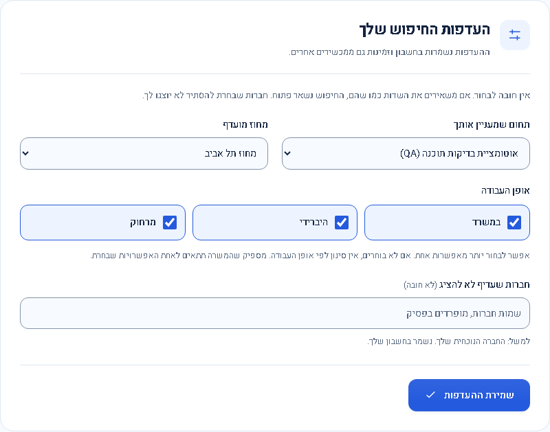
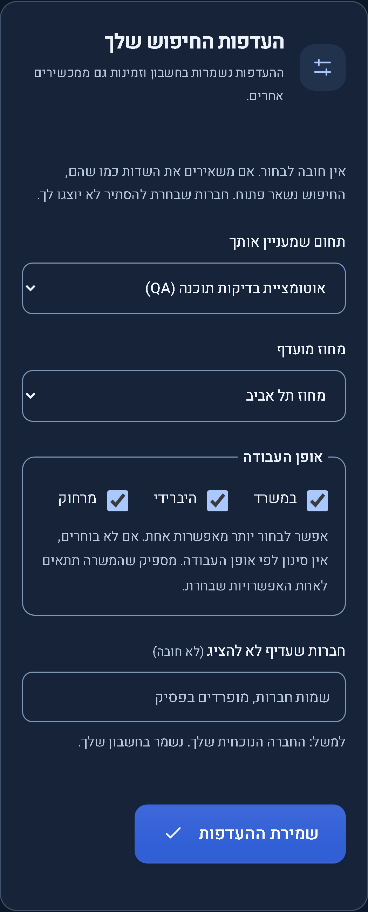
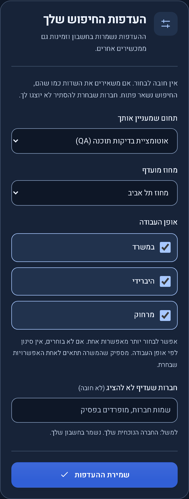
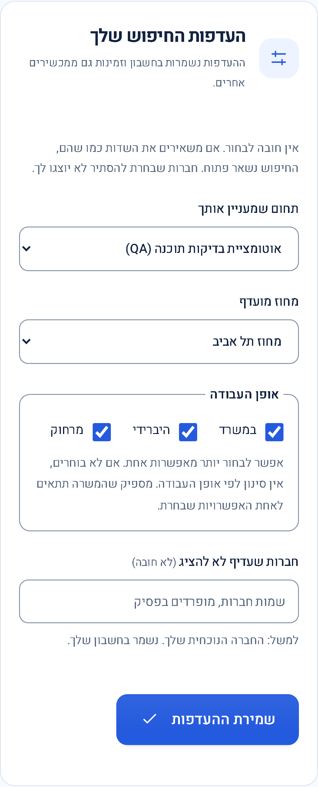
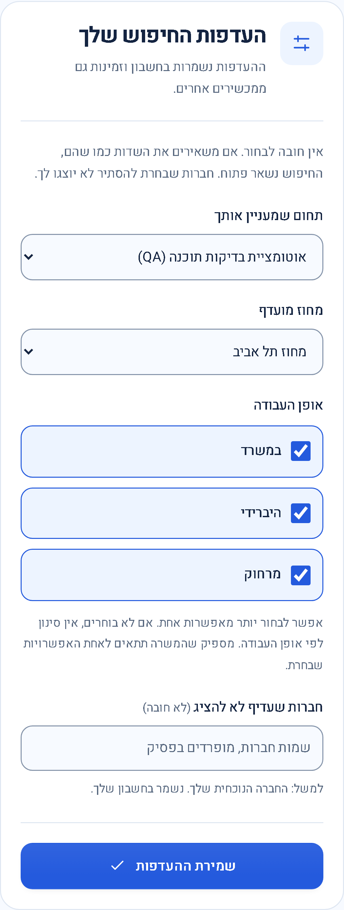

# Search preferences card

Application0.4.1 release candidate, 2026-10-28; publication pending. Previous published release:0.4.0 / Sites48; its assistant capability is preserved. Compatible presentation repair; no data, API, configuration or migration change.

The card uses compact field spacing, aligned category/district controls, larger work-style tiles with clear selected states and a separate save footer. Native checkboxes remain keyboard accessible and multi-select. Tiles stack on mobile. The page-specific stylesheet avoids changing the shared filter and onboarding components. An existing form-grid gap was adding space on top of header/footer margins; the page now uses a single spacing scheme. Its only new motion is a160ms tile color transition, disabled when reduced motion is requested.

Actual running `/app/preferences` form captures use the same synthetic account and settings (QA automation, Tel Aviv district, all three work styles selected, no hidden companies), viewport, theme, zoom and data. Mobile viewport:390 ×664 at device scale factor3; desktop:1440 ×1000. Only the card is captured.

| View          | Before                                                                                                                  | After                                                                                                                            |
| ------------- | ----------------------------------------------------------------------------------------------------------------------- | -------------------------------------------------------------------------------------------------------------------------------- |
| Desktop dark  |          |  |
| Desktop light |  |                    |
| Mobile dark   |                      |                      |
| Mobile light  |                          |                     |

Product changes: `src/app/pages/preferences.html`, `src/styles.css` and scoped `src/styles/preferences.css`. No save or preference-state implementation changed. `tests/preferences-layout.spec.ts` covers both themes, large label targets, overflow at320/700/768/1440px, accessibility, keyboard selection, account save payload and persistence after reload. Existing `preferences-theme.spec.ts` covers guest persistence, empty selection meaning all work styles, onboarding reuse and theme behavior. Only synthetic account writes are used in tests.

Review and checks: no blocking product findings in CSS scope, selection semantics, focus visibility, touch target sizing, RTL placement or save behavior. Production build, both frontend-test/browser-test TypeScript checks,59 frontend unit tests and54 Chromium browser checks across the new layout, existing preferences/theme and existing UI review suites passed. Changed files passed formatting and whitespace checks. Mobile evidence uses browser emulation; physical devices and other browser engines were not reassessed.

Publication scope: an unpublished0.4.0 assistant capability update was added to GitHub main during this task. Its source is preserved on main. This preferences release is prepared separately from the published0.3.5 baseline, so its checks and deployment do not claim to release or validate that separate assistant capability.

Publication reconciliation: the assistant update subsequently went live as0.4.0 / Sites48 before this patch could be pushed. Its source and backend are retained exactly; the preferences repair therefore becomes0.4.1. The earlier0.3.6 candidate was never published. The source helper rejected the stale push; no force push or rollback was used.

Final integration verification: the0.4.1 production build, frontend-test/browser-test TypeScript checks,59 frontend unit tests and all54 browser checks passed again using a restarted preview of the combined source. All184 existing product files outside the preferences template/style import are byte-for-byte identical to the published Sites48 baseline, including assistant and server files. The build retains the existing assistant stylesheet budget warning. Before captures were taken on0.3.5;0.4.0 changed the assistant and left the preferences implementation unchanged. After captures are from the final0.4.1 build with matching synthetic settings and dimensions.
