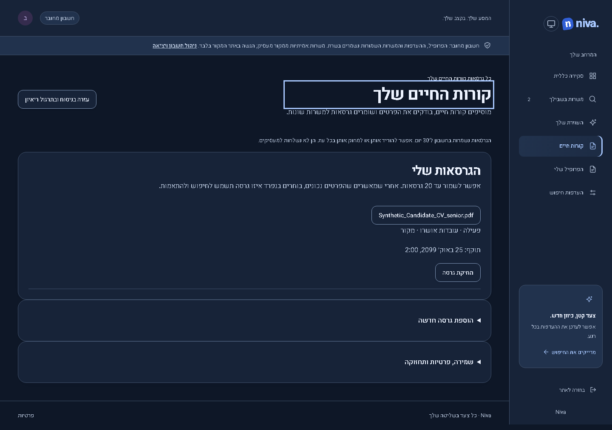
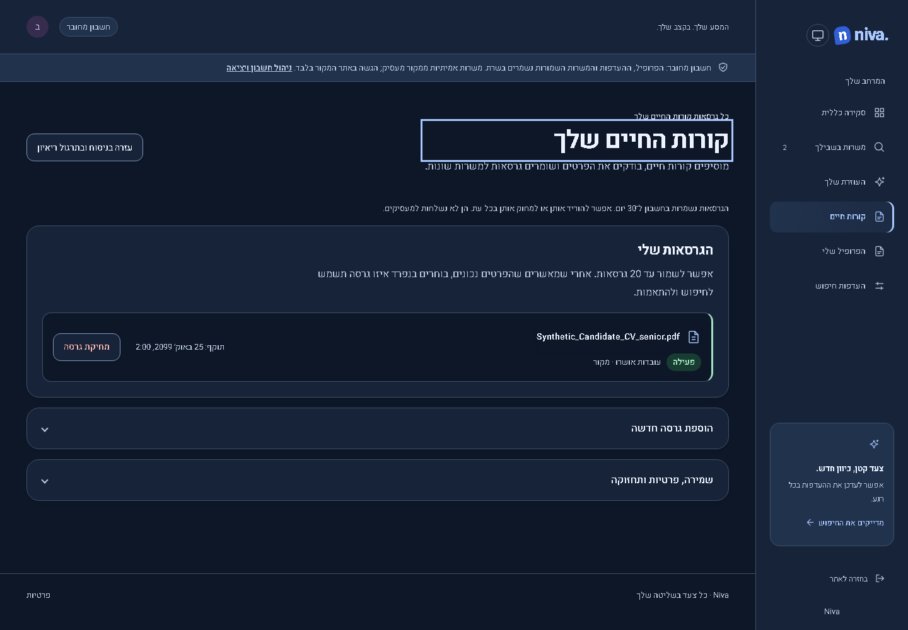
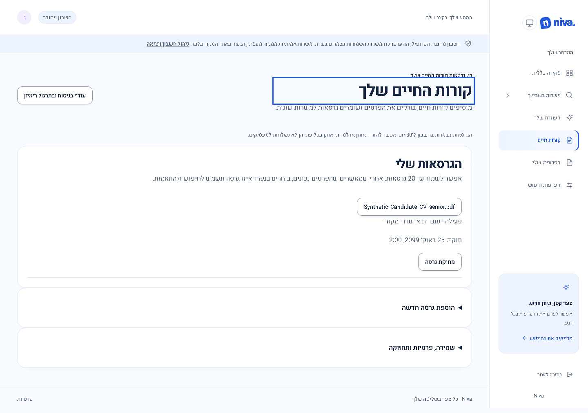
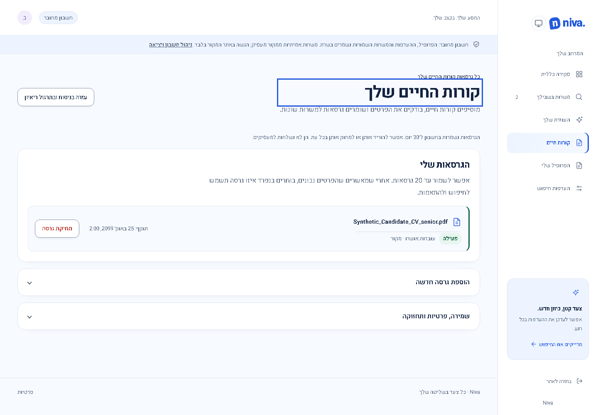
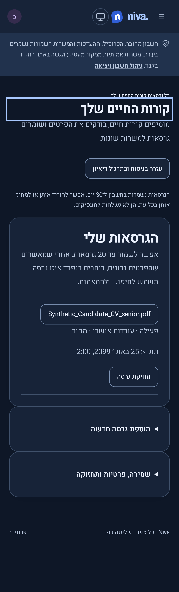
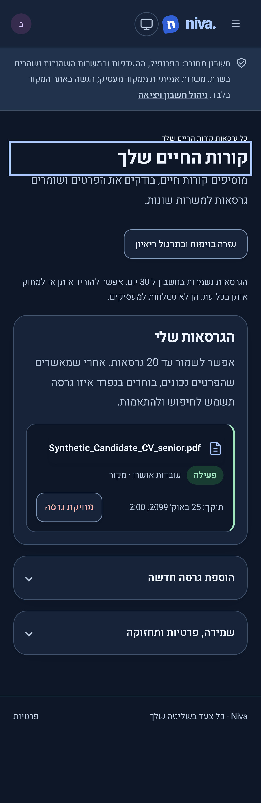
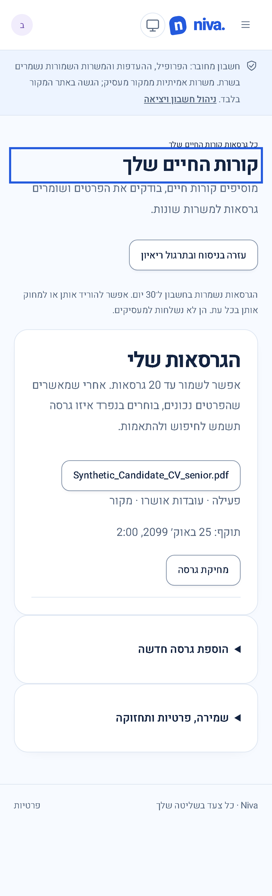
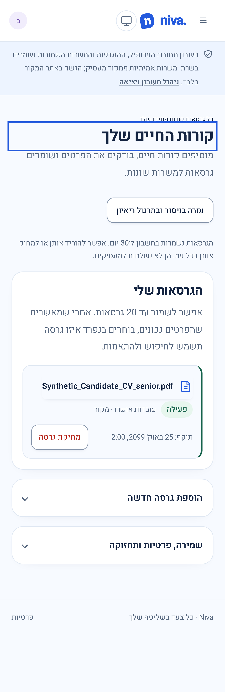

# Résumé versions layout

Release candidate **0.3.3**, 2026-10-28; publication pending. Previous published application: **0.3.2 / Sites44**. This compatible visual repair changes no account data, API contract or configuration. Package and lockfile versions advance together.

The previous list stacked every field in a full-width panel, and adjacent disclosure panels touched. The updated layout groups each version into a compact row with an active badge, aligned expiry and delete action, and a mobile reflow. Disclosure panels have 16px separation, full-width keyboard-accessible summaries and down/up chevrons. Native details behavior, review/activation and deletion confirmation are preserved.

All images show the running `/app/resumes` implementation with the same synthetic filename and account data, viewport, theme, zoom and scroll position. No private résumé is used.

| View                             | Before                                                                                                            | After                                                                                                                    |
| -------------------------------- | ----------------------------------------------------------------------------------------------------------------- | ------------------------------------------------------------------------------------------------------------------------ |
| Desktop dark, 1440 × 1000        |  |  |
| Desktop light, 1440 × 1000       |     |           |
| Mobile dark, 390 × 664 viewport  |                    |      |
| Mobile light, 390 × 664 viewport |                  |                        |

Changed product files: `src/app/pages/resumes.html`, `src/app/pages/resumes.ts`, `src/styles/career.css`. Layout verification: `tests/resume-layout.spec.ts`; existing résumé and UI review journeys cover review, draft switching, deletion focus and narrow-screen reflow. Screenshots are full-page captures; mobile files use device scale factor 3.

Verification: production build and browser-test TypeScript check passed. All 56 browser checks across the layout, career and existing UI review suites passed on desktop and mobile. After the final disclosure sizing/chevron adjustment, the build and all four layout checks passed again, including both themes, overflow, keyboard disclosure operation, accessibility audit, version selection and cancellation of deletion. Historical screenshots produced by existing tests were restored. No hosted verification or publication was performed.

## Pre-publication code review — 2026-10-28

Reviewed template bindings, CSS cascade and scope, right-to-left placement, filename wrapping, status semantics, native disclosure keyboard behavior, focus visibility, disabled actions, deletion confirmation and unchanged review/activation logic. No blocking product findings were identified. Added a stress regression for 20 versions, long unbroken filenames at 320/700/768/1440px and empty-library creation. Its first run found an ambiguous test locator matching both version 0 and version 10; exact-name selection corrected the test. No product change was needed.

Final review checks: 59 frontend unit tests, both frontend-test and browser-test TypeScript checks, and production build passed. On a dedicated preview of this checkout, 56 existing/layout checks passed; after correcting the test locator, all six layout/stress checks passed. The first attempted review run reused another checkout's local preview and was discarded. Review scope is this presentation change; backend/provider and hosted retention guarantees were not reassessed.
