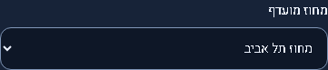
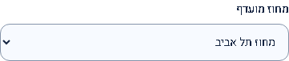
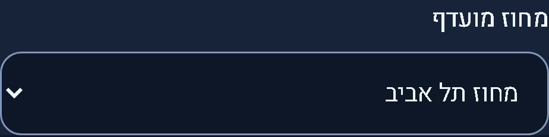
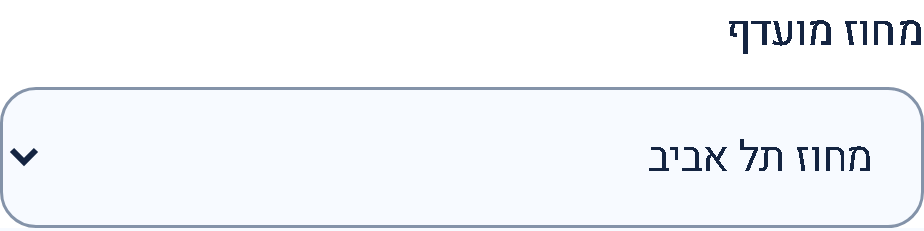
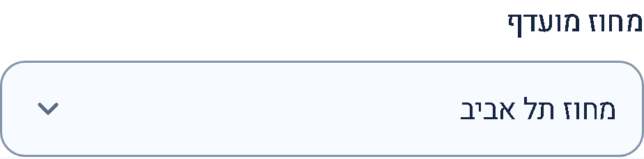

# Consistent dropdown arrow inset

Published application **0.4.2 / Sites50**, 2026-10-28. [Publication/live receipt](../../verification/publication-20261028-v50.json). Previous published version:0.4.1 / Sites49. Compatible shared presentation fix; no data, API or configuration change.

Single-select dropdowns now use a theme-aware decorative chevron16px inside the trailing edge, with44px trailing padding to keep the selected text clear. RTL places it on the left; LTR places it on the right. This shared rule overrides form-specific padding consistently without replacing native controls or adding JavaScript. Native options, labels, selection, keyboard operation and focus remain intact. Forced-colors mode restores the platform appearance and arrow; multiple selects and list boxes are excluded.

Only `src/styles/tokens.css`, `src/styles/select.css` and its import in `src/styles.css` change product behavior. During review, a scoped profile-field padding rule initially overrode the global spacing; the final selector handles that cascade. Both local and hosted content-security policies already permit the embedded decorative SVG.

These matched actual running `/app/preferences` captures show the district control with the same synthetic account, selected Tel Aviv district, theme, viewport, zoom and data. Desktop viewport1440 ×1000; mobile390 ×664 at device scale factor3. The label and control are cropped together.

| View          | Before                                                                                             | After                                                                                                       |
| ------------- | -------------------------------------------------------------------------------------------------- | ----------------------------------------------------------------------------------------------------------- |
| Desktop dark  |          |  |
| Desktop light |      |            |
| Mobile dark   |             |                             |
| Mobile light  |  |                |

Additional browser evidence is after-only: [Firefox dark](select-arrow-firefox-dark/after.png), [Firefox light](select-arrow-firefox-light/after.png), [WebKit dark](select-arrow-webkit-dark/after.png), [WebKit light](select-arrow-webkit-light/after.png). These are not presented as paired comparisons.

`tests/select-affordance.spec.ts` checks computed appearance, inset, image, size and trailing padding on every single select across preferences/profile/jobs, plus onboarding keyboard selection, LTR placement and forced-colors fallback. Focused checks passed on Chromium desktop/mobile emulation, Firefox and WebKit (12 checks). Physical mobile devices and native platform popup rendering were not inspected; the popup implementation remains the browser's own.

Final verification: production build, both frontend-test/browser-test TypeScript checks,59 frontend unit tests and28 Chromium browser checks passed across dropdowns, preferences/theme, candidate-profile and preferences-layout tests. These checks include accessibility and narrow-screen overflow coverage. Changed files passed formatting and whitespace checks. Historical screenshots overwritten by existing test capture routines were restored. The existing assistant stylesheet budget warning remains unchanged; no assistant or server implementation changed.

Live verification: custom-domain build metadata matches the reviewed GitHub and Sites source mapping. All17 dropdowns across preferences(2), profile(5) and jobs(10, including advanced filters and sorting) use the same16px arrow inset and44px trailing padding in Chrome. Onboarding, LTR and forced-colors cases were checked in the local cross-browser tests. No private preferences/profile data were changed. The live user preview stays local; repository captures use synthetic data only.
