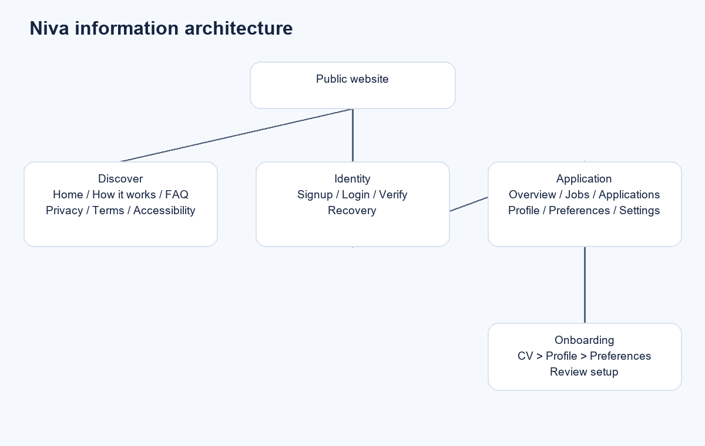
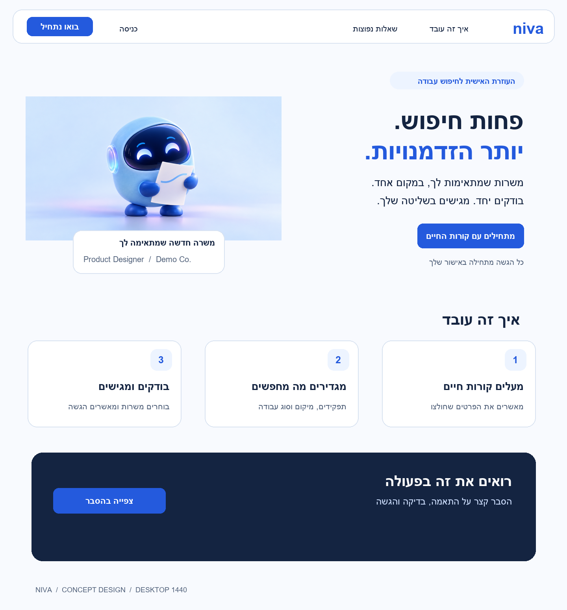
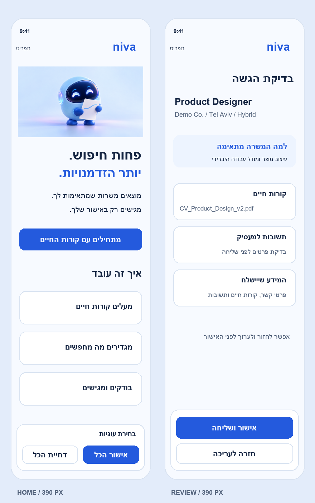
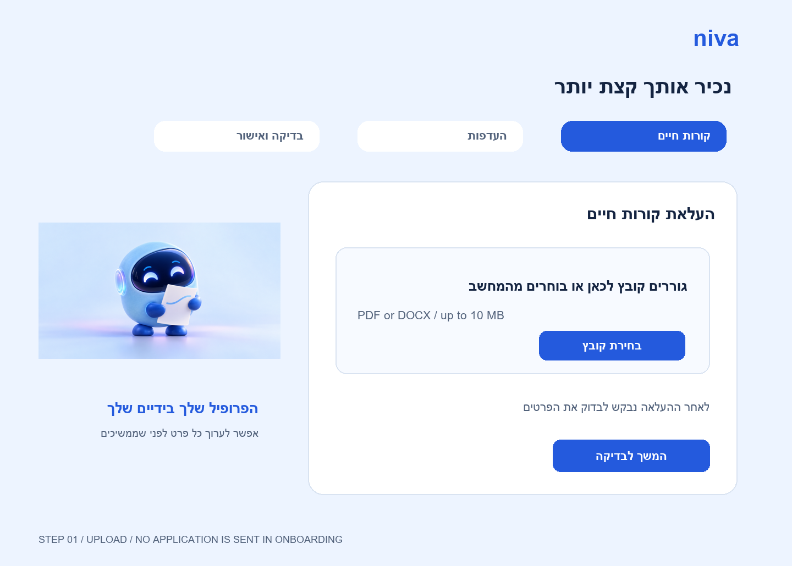
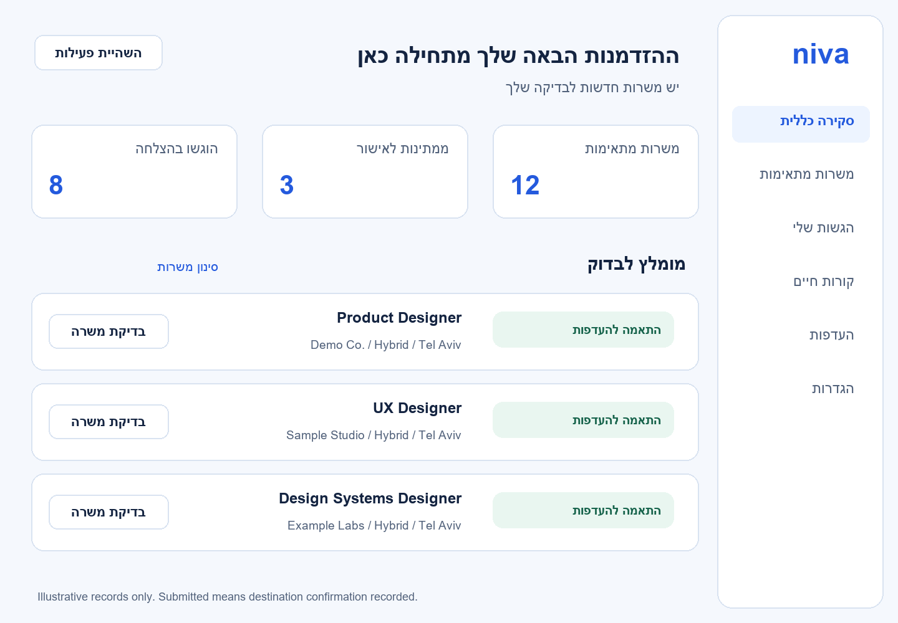
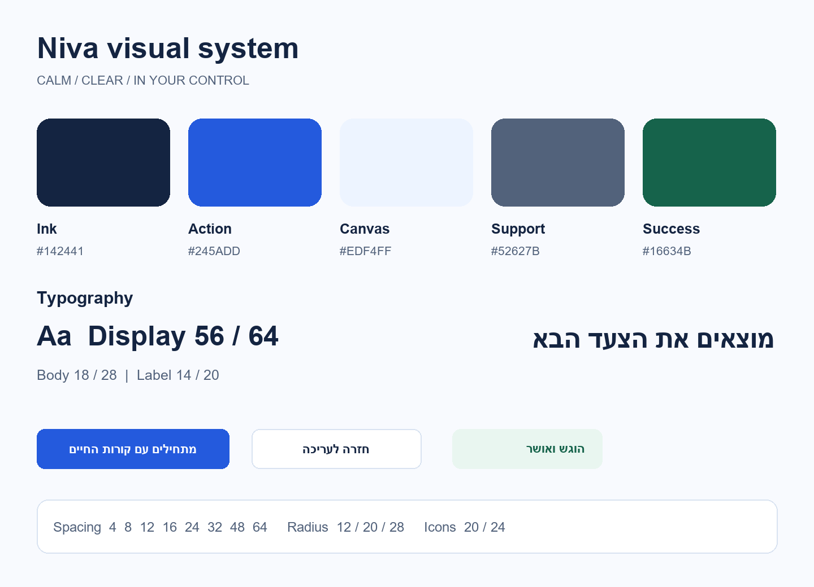
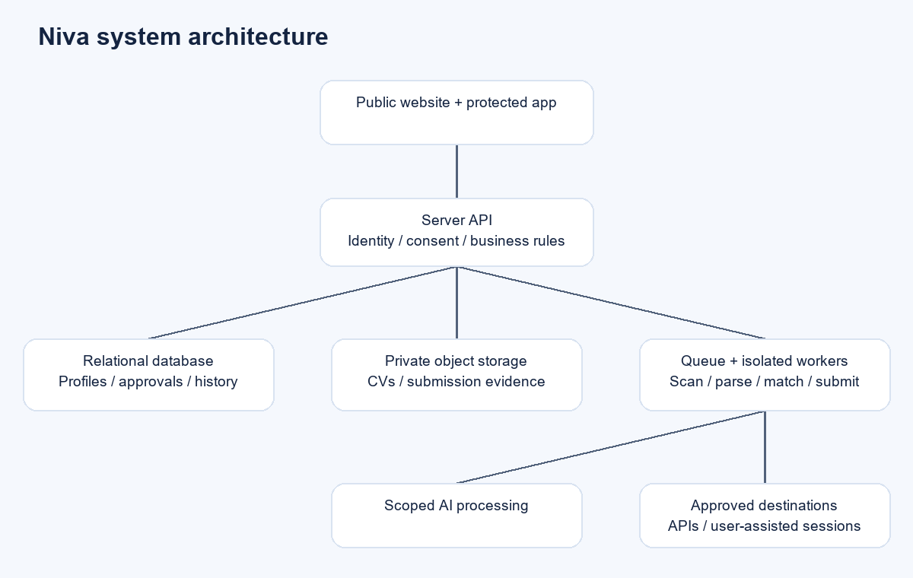

# AI job assistant website specification

Niva concept | Product, experience and implementation | Version 1.0 | 23 October 2026

## Purpose

Create a Hebrew-first website and companion web application that help job seekers discover suitable roles, review their application details and submit through supported destinations. This specification defines the proposed scope, screen behavior, visual system, engineering requirements and release criteria.

## Recommended direction

Use a warm, clear marketing experience to explain the service, then make candidate control visible throughout the product. Launch with review before every submission and a small set of validated integrations.

## How to use this document

Product and design should agree on scope and flows first. Engineering can then estimate the requirements and integration contracts. QA should use the numbered acceptance criteria. Niva is a working concept name requiring brand clearance before commercial use.

Original concept artwork generated for this specification. The brand and screens are proposed designs.

# Document contents

Select a section below or use the PDF bookmarks to navigate.

1. AI job assistant website specification
3. Product brief and success measures
4. Reference site assessment
5. Users and end to end journey
6. Scope and release priorities
7. Information architecture and routes
8. Sitemap planning graphic
9. Homepage requirements
10. Desktop homepage visual design
11. Mobile layouts and application review
12. Identity and onboarding requirements
13. Onboarding visual design
14. Dashboard and job discovery requirements
15. Dashboard visual design
16. Visual system and design tokens
17. Components and interaction states
18. Responsive RTL and accessibility
19. Content and graphic production plan
20. Data model and content contracts
21. System architecture and integrations
22. Application workflow and authority
23. Architecture planning graphic
24. Privacy security and account controls
25. Performance SEO and analytics
26. Quality assurance and acceptance criteria
27. Delivery plan ownership and decisions
28. Sources and deliverable manifest
# Product brief and success measures

A useful service must create relevant opportunities and a reliable record of candidate actions.

## Audience and value

Primary audience: Hebrew-speaking job seekers applying to professional roles in Israel. Secondary audience: bilingual candidates pursuing local and international roles. The service reduces repeated searching and form entry while allowing the candidate to decide where personal information is sent.

## Business objective

Move visitors from understanding the service to a complete profile and their first confirmed application. Monetization can follow demonstrated value; billing is excluded from the first release until price, entitlements and support policies are approved.

## Success definitions

Activation: an account has a confirmed CV profile, saved role preferences and at least one reviewed job within seven days of signup. First value: time from verified signup to first reviewed match. Submission success: destination-confirmed submissions divided by attempted supported submissions, excluding candidate cancellations. Duplicate prevention: blocked duplicates reported separately from errors.

## Measurement and initial gates

Track the funnel by acquisition channel and device using consented aggregate data. Proposed pilot gates: zero duplicate submissions in the acceptance suite, 100% of submitted statuses backed by confirmation evidence, and at least 95% success for the controlled supported-destination test set. Conversion targets must be set after a baseline; these are proposed quality gates, not observed performance.

## Product boundaries

No promise of interviews, employment, universal job-board coverage or a particular application volume. The service assists candidates; employers make recruitment decisions. Do not display fabricated testimonials, partner badges, user counts or match probabilities.

# Reference site assessment

Observed public experience and the ideas carried into the new design.

## What was observed

The Tobi homepage presents a Hebrew RTL AI job application service with a light blue background, a friendly 3D octopus-style mascot, a large two-line headline, a signup CTA and an explainer video. The page includes floating destination logos, a social-proof claim, privacy and accessibility links, and cookie controls. These observations come from the public page and browser inspection on 23 October 2026. [S1]

## Public supporting pages

The signup page introduces account creation and links to login, terms and privacy. The privacy page describes CV profiles, search preferences, activity logs, AI processing and session-based browser interactions. Those descriptions are published claims, not independently verified implementation behavior. [S2, S3]

## Accessibility evidence

The reference accessibility statement describes Hebrew RTL, labels, focus styles and status announcements. It also says authenticated screens were outside its public audit and describes partial bilingual coverage. A dedicated pricing page is reported as absent there; this specification does not assume an existing pricing product. [S4]

## Design translation

Retain the clarity of one primary action, the reassuring blue atmosphere and a personable assistant. Use a distinct robot mascot, original copy and a structured navigation system. Replace unsupported trust claims with a product demonstration and an explanation of candidate controls. Use destination names or logos only where integrations are verified and usage rights are established.

## Research boundary

The public homepage and supporting pages informed this document. No account was created and no application was submitted. Onboarding, dashboard, integrations and administration below are proposed requirements, not representations of Tobi private screens. The concept does not reuse Tobi branding, artwork or copy.

# Users and end to end journey

Design for first-time setup and repeated use under time pressure.

## Core user needs

Active job seeker: find relevant jobs quickly and avoid repeating profile information. Career changer: explain transferable skills and adjust role criteria. Experienced candidate: exclude current employers and restrict locations, work models and seniority. Every user must understand what will be submitted and how to stop activity.

## Primary journey

Discover value on homepage > create and verify account > upload CV > review extracted profile > save search preferences > inspect matches > open job detail > review exact application payload > approve submission > receive confirmed or attention-needed result > track progress.

## Returning journey

Sign in to overview, inspect jobs awaiting review, filter applications by status, update preferences or CV, and pause activity. Changing a CV must not rewrite a historical application record. Show the precise version used in each submission.

## Recovery journeys

Scanned CV: explain that extraction failed and allow manual profile entry or a different file. No matches: show active filters and allow widening them. Destination requires login or CAPTCHA: pause and ask the user to complete the step in the destination session. Uncertain submission: show Needs verification and prevent automatic resubmission.

## Experience principles

Explain the next action in one sentence. Preserve completed work after errors. Distinguish saved preferences from submission authority. Never use a friendly mascot to soften a critical disclosure. Place the primary action next to a plain explanation of its effect.

# Scope and release priorities

A complete marketing site with a deliberately bounded application workflow.

## P0 launch scope

Public homepage, explainer content, FAQ, signup, login, verification and recovery; privacy, terms and accessibility pages; CV upload and profile confirmation; job preferences and employer exclusions; job discovery through one or two approved destinations; match detail and reasons; review and submission; activity history; notification settings; account export and deletion request; limited support administration.

## P1 after pilot

Saved jobs, configurable job alerts, additional approved destinations, CV version management, interview-stage labels set by the candidate, improved reporting and English localization. Add billing only after defining plan entitlements, fair-use limits, cancellation and refund handling.

## P2 exploration

Candidate-approved batch submissions, bounded background automation, cover-letter drafting and deeper employer-response integrations. These need separate quality evidence and consent design. Generated text remains editable and must not invent qualifications.

## Explicit exclusions

Employer applicant screening, candidate ranking for employers, interview guarantees, resume fabrication, bypassing destination access controls, universal scraping, storing destination passwords for reuse, and silently sending applications. A native mobile application is outside scope; responsive web is required.

## Release dependency

The first supported connector must pass authentication, data-rights, duplicate prevention, confirmation and failure-recovery tests before marketing names it. If a destination cannot support reliable submission, offer an outbound handoff and label it Manual completion required.

# Information architecture and routes

Public discovery and authenticated work have separate navigation systems.

## Public routes

/ : marketing home. /how-it-works : detailed explanation and supported destinations. /faq : searchable or grouped answers. /signup, /login, /verify-email, /forgot-password and /reset-password : identity flows. /privacy, /terms, /accessibility and /contact : trust and support. A /pricing route is reserved for the later commercial release.

## Application routes

/app : overview. /app/onboarding : resumable setup. /app/jobs and /app/jobs/:id : matches and detail. /app/applications and /app/applications/:id : history and evidence. /app/profile : confirmed CV data. /app/preferences : search criteria and exclusions. /app/settings : account, notifications, privacy and sessions.

## Navigation behavior

Desktop public header has logo on the right, How it works and FAQ, then login and signup. App navigation is a right sidebar with overview, jobs, applications, CV, preferences and settings. Mobile uses a labelled menu and a compact three-item app bar for overview, jobs and applications; secondary settings live in the menu.

## Route and content controls

Protect app routes on the server. Redirect users to the intended route after sign-in. Hide authenticated content from indexing and shared caches. Show a recoverable 404 with home or jobs navigation. Expired or removed job links retain application history and offer current alternatives.

# Sitemap planning graphic

Public routes lead into a protected and resumable candidate workspace.

The editable SVG is included in the design package. Lines show navigation relationships, not a mandatory sequence for returning users.

# Homepage requirements

The page should explain the offer and move visitors into setup without making unsupported claims.

## H01 header and hero

Use one H1, a concise supporting paragraph, an original companion image and the primary CTA Start with your CV. The CTA opens signup for visitors and resumes onboarding for authenticated users. Secondary action Watch the explanation scrolls to the video. Keep the main action visible within the first viewport at 390 x 844 and 1440 x 900 without hiding essential text.

## H02 page sequence

Header > hero > three-step explanation > actual product preview > supported-destination disclosure > control and privacy explanation > FAQ > final signup CTA > legal footer. The mockup illustrates the leading sections. Product screenshots must use sample records and a clear illustration label until real, approved demonstrations exist.

## H03 video and FAQ

Load a static poster first. Start video only after activation; provide captions, transcript, volume and playback controls. FAQ must answer what is sent, which destinations work, how to pause, whether results are guaranteed and how personal data is handled. Accordion buttons expose expanded state and remain keyboard accessible.

## H04 trust and cookie controls

Show no user count or testimonial until an owner supplies evidence and usage permission. Cookie banner offers equally accessible Accept all, Reject optional and Manage. Do not initialize optional analytics before consent. Consent changes are available in the footer and take effect without forcing a new account session.

## H05 content ownership

Marketing owns public copy, product owns capability claims, design owns visual assets and the responsible legal owner approves notices. Home, FAQ and explainer content may be published through a lightweight CMS with preview, version history, roles and rollback.

# Desktop homepage visual design

A spacious RTL composition pairs an original mascot with a direct product explanation.

1440 px concept. Header, hero, process cards and video teaser. The full page adds the trust section, FAQ and footer defined in Homepage requirements.

# Mobile layouts and application review

The primary action remains reachable while decision details stay visible.

390 px concept screens. Left: home with cookie choice. Right: review before submission. Company, role and file names are illustrative.

# Identity and onboarding requirements

Setup is resumable and produces a profile the candidate has explicitly checked.

## A01 account access

Use verified email with a short-lived sign-in link as the recommended launch method. An identity provider can supply Google sign-in after configuration. Include generic responses to email lookup, rate limits, resend cooldown, expired-link recovery and a clear sign-out. Keep terms acknowledgement separate from optional marketing consent; save the notice version and timestamp.

## O01 upload and extraction

Accept PDF and DOCX up to 10 MB after MIME and content validation. Reject encrypted, malicious, empty or unsupported documents with a specific next step. Upload to private storage using short-lived signed access. Run malware scanning before parsing. Show uploading, scanning, extracting, complete and failed states; allow cancellation and replacement.

## O02 review extracted profile

Show name, email, phone, roles, experience, education, skills, languages and links as editable fields. Mark uncertain or missing extracted values. Do not infer credentials or sensitive characteristics. Only candidate-confirmed data may populate application answers. A scanned document fallback offers manual entry without forcing a paid tool.

## O03 preferences

Require target role, at least one location or remote selection, work model and seniority. Employment type and skills are optional. Salary range is optional with explicit currency and gross monthly or annual unit. Include employer exclusions and prevent a current-employer field from becoming a required disclosure. Save after each step with a visible saved indicator.

## O04 completion and validation

Final summary shows profile, preferences, selected destinations and review-before-send mode. Completion creates no application. Validate both client and server; move focus to an error summary and link errors to fields. Back navigation preserves data. Leaving and returning resumes the last incomplete step.

# Onboarding visual design

Make the upload step simple and explain the review that follows.

Desktop concept for step 1. Subsequent steps reuse this layout for extracted profile review, preferences and final setup confirmation.

# Dashboard and job discovery requirements

Prioritize jobs requiring a decision and the status of work already requested.

## D01 overview

Show counts for eligible matches, pending approvals and confirmed submissions using server-calculated values with an updated-at timestamp. Provide a prominent pause action and an activity feed. On first use, show a setup checklist instead of empty metrics. If data is stale or refresh fails, retain the last result and label its age.

## J01 job list

Each job card shows title, company, location, work model, source, posting date when supplied, current availability and a plain match explanation. Filters include role, location, model, seniority, source and saved or reviewed state. Preserve filters in URL parameters where no personal data is exposed. Use server-side pagination and stable ordering.

## J02 relevance

Apply hard exclusions before relevance ranking. Reasons link to candidate-confirmed skills and preferences; missing evidence is stated as Unknown. The launch UI uses explanatory categories rather than a percentage that implies calibrated probability. The candidate can hide a job or report a poor match and see how preferences affect results.

## J03 detail and review

Job detail includes the original source link, description, known requirements, why it matched and mismatches. Review displays employer and destination, exact CV version, contact data, screening answers and generated text with edit controls. Explicit approval creates an immutable snapshot before queueing submission.

## J04 no result and conflict handling

If nothing matches, preserve filters and suggest specific changes. If a job closes between review and send, stop with Job unavailable. If a candidate changes their profile after approval, keep the approved snapshot or require a fresh approval for any changed payload. Never substitute another CV silently.

# Dashboard visual design

The right sidebar anchors navigation and each job has an obvious review action.

1440 px concept. All jobs and counts are sample data. A submitted status must reflect destination confirmation, as defined in the workflow requirements.

# Visual system and design tokens

Use the same foundations across public pages, forms and the application.

Design board. Hebrew production typography: Heebo; English: Inter. Arial is used in these portable specification graphics. Validate final font licensing and rendering.

# Components and interaction states

A reusable component library keeps behavior consistent across every screen.

## Tokens and grids

Colors: ink #142441, action #245ADD, canvas #EDF4FF, muted text #52627B, border #D9E3F1 and success #16634B. Semantic errors use #B42318 on #FFF1F0; warnings use #8A4B08 on #FFF6E5. Use 4, 8, 12, 16, 24, 32, 48 and 64 px spacing; radii 12 for controls, 20 for cards and 28 for hero panels. Desktop content max width 1280 px with 32 px gutters.

## Typography

Production Hebrew uses Heebo and English uses Inter with system fallbacks. Display: 56/64 desktop and 36/44 mobile. H2: 36/44 and 28/36. Body: 18/28 marketing and 16/24 application. Labels: 14/20. Avoid text inside artwork. Ensure font loading does not shift the hero or hide text.

## Required components

Buttons: primary, secondary, text and destructive. Inputs: email, text, password if enabled, select, multi-select, checkbox and file upload. Navigation: header, sidebar, mobile menu, tabs and breadcrumbs. Feedback: toast, alert, status chip, inline error, error summary, skeleton, empty state and progress indicator. Data: job card, filter bar, application row, timeline and review panel.

## State behavior

For interactive components define default, hover, focus-visible, active, disabled and busy states. A busy action retains its label and explains progress; prevent repeat submission. Status chips combine words and icons, not color alone. Toasts supplement persistent outcomes and do not carry the only error explanation. Dialogs trap focus, support Escape where safe, and restore focus.

## Motion and mascot use

Use 120-200 ms opacity or position transitions for feedback. Optional mascot movement must be subtle, stop under reduced-motion preferences and never move critical controls. Avoid autonomous video, animated logo walls and constant dashboard activity that imply work is happening when it is not.

# Responsive RTL and accessibility

Hebrew is the primary product language and accessibility is a release requirement.

## RTL implementation

Set lang=he and dir=rtl at the root. Use logical CSS properties such as margin-inline and inset-inline-end. Mirror navigation order and directional chevrons, but preserve familiar playback icons and logos. Isolate emails, URLs, phone numbers, file names, salary units and job titles with bdi or explicit direction so mixed content remains readable. Keyboard focus order follows the reading and task order.

## Responsive rules

Below 768 px, use one column with 16-20 px gutters and stacked cards. Between 768 and 1199 px, use 24 px gutters and collapse the sidebar to a labelled menu. At 1200 px and above, use a 12-column layout and a 240-264 px right sidebar. Review actions can be sticky on mobile with safe-area padding, but must never cover fields or focused controls. Replace wide history tables with labelled cards.

## Accessibility acceptance

Target WCAG 2.2 AA across public and authenticated routes. Use semantic landmarks, one H1 per page, skip navigation, associated input labels, useful error text and status announcements. Normal text contrast must be at least 4.5:1 and large text at least 3:1. UI boundaries and essential indicators must meet applicable non-text contrast. Provide visible focus and a 44 x 44 px design target for touch controls. [S5]

## Verification

Test keyboard-only completion, NVDA with Chrome on Windows, and VoiceOver with Safari on iPhone. Check 200% text zoom and reflow at 320 CSS px without page-level horizontal scrolling. Validate both Hebrew and mixed Hebrew-English content, video captions, reduced motion and focus after errors. Automated scans supplement manual testing; they do not establish conformance on their own.

# Content and graphic production plan

Copy should describe observable actions and graphics should explain the product.

## Tone and sample microcopy

Use concise, calm Hebrew. Main CTA: Start with your CV. Approval: Approve and submit. Pending state: Waiting for your approval. Unknown outcome: We could not verify submission. Check the destination before trying again. Avoid claims such as Guaranteed interviews or We apply everywhere. The English copy here describes the intended meaning; Hebrew UI examples appear in the visual boards.

## Content inventory

Required before build completion: approved value proposition, three setup steps, supported-destination list, six to ten FAQ answers, a 60-90 second explainer script and transcript, onboarding instructions, all empty and error states, operational emails, support instructions and approved legal notices. Every claim has an owner and review date.

## Graphics inventory

A01 hero: original companion illustration supplied as niva-hero.png; export responsive AVIF or WebP variants and crop for mobile without losing the document. A02 desktop homepage, A03 mobile home and review, A04 onboarding, A05 dashboard and A06 token board are supplied concept PNGs. A07 sitemap and A08 architecture are supplied vector SVGs. Interface text remains live HTML in the implementation.

## Production asset requirements

Provide a cleared wordmark as SVG, 20/24 px icons from one licensed library, explainer poster at 1600 x 900, caption file in WebVTT and social preview at 1200 x 630. Use decorative empty alt text for redundant art and meaningful alt text for informative images. Do not make job-board logos imply a partnership. Final brand mark, video and additional mascot poses are production tasks, not supplied assets.

## Publishing workflow

CMS editors can draft and preview; publishers approve releases. Keep localization keys outside layouts. Review all pages for placeholders, unsupported claims, outdated destination coverage and personal data. Source artwork and usage rights must accompany the final asset handoff.

# Data model and content contracts

Keep candidate facts, approved payloads and external outcomes separate.

## Core entities

User: id, verified email, locale, timezone, created_at. CandidateProfile: user_id, confirmed fields, version, confirmed_at. ResumeVersion: id, user_id, private object key, original filename, MIME type, scan state, hash and created_at. PreferenceSet: user_id, role terms, locations, work model, seniority, salary unit and employer exclusions. Job: id, source key, canonical URL, employer, location, description hash, availability and fetched_at.

## Application records

Application: id, user_id, job_id, status, approved_payload_id, destination, idempotency key and timestamps. ApprovedPayload: immutable contact fields, resume_version_id, answers, optional text, consent_version and approval_at. Attempt: application_id, connector_version, attempt number, outcome, external reference and evidence pointer. ConsentEvent: purpose, version, grant or withdrawal, timestamp and actor. Notification: template, channel and delivery state.

## Integrity rules

Enforce tenant ownership on every query and private object. Maintain a uniqueness boundary for user plus canonical destination job, with explicit review before any permitted reapplication. Never overwrite approved payloads or historical evidence when a profile changes. Store unknown source values as null; do not invent posting dates or employer responses. Store times in UTC and display in the candidate timezone.

## Service contracts

POST /resumes creates a signed upload and returns a scan job id. PATCH /profile uses version checking and reports conflicts. GET /jobs supports cursor pagination and filters. POST /applications/preview validates and returns a payload hash. POST /applications requires that hash, explicit approval and an idempotency key. POST /applications/:id/cancel cancels pending work where possible. GET /applications/:id returns status plus safe evidence metadata.

## Contract errors

Use stable error codes and user-facing translations: file_unsafe, extraction_failed, profile_incomplete, job_closed, approval_stale, duplicate_application, destination_auth_required and submission_unverified. Return request ids for support without exposing stack traces or private provider data. Validate authorization independently of a supplied user_id.

# System architecture and integrations

A modular web application delegates slow work to isolated background services.

## Proposed implementation

Use a typed React web framework with server-rendered public pages and a protected application shell. A server API manages identity, authorization and business rules. A relational database stores records; private object storage holds CVs and evidence. A queue runs scanning, parsing, matching and connector work. These are proposed implementation choices, subject to team and hosting decisions.

## Integration adapter contract

Every destination adapter exposes capability metadata, authentication requirements, job retrieval, field mapping, preview validation, submit and confirmation verification. Prefer official APIs and approved feeds. Browser automation requires destination review and a user-assisted session where necessary. Show which actions each destination supports and when its coverage was last tested.

## AI processing boundary

A dedicated service extracts structured profile data and proposes match reasons or answers. Treat job descriptions and documents as untrusted data, never system instructions. Validate model outputs against schemas and source evidence. Missing facts remain unanswered. AI never receives authority to override consent, change recipient destinations or invent candidate qualifications.

## Operational isolation

Separate web traffic from worker execution. Scope worker access to one task and candidate payload, restrict outbound requests to approved destinations, and use per-connector concurrency limits. Store secrets in a managed secret store. Stream safe progress events or poll a status endpoint; the database is the source of truth.

## Observability and handoff

Record state transitions, queue age, connector success, unverified outcomes and alert volume with correlation ids. Exclude CV text and screening answers from general logs. Maintain a connector kill switch, candidate pause and an operator pause. A failure in one destination must not stop all matching and review activity.

# Application workflow and authority

A submission is an external action with a durable candidate approval record.

## State machine

Draft > Awaiting approval > Queued > Running > Submitted. Alternate states: Needs action, Failed, Unverified, Cancelled and Job closed. Submitted is allowed only after destination confirmation. Queue acceptance is never submission proof. An application detail timeline shows timestamps and the current next action.

## Approval boundary

Approval covers a named employer and destination, exact CV version, contact details, answers and any cover letter. Create a payload snapshot and hash when approved. Material changes invalidate approval. Marketing consent and account registration do not authorize applications. Launch requires separate approval for every application.

## Retries and duplicates

Use a deterministic idempotency key and a durable attempt log. Retry transient failures only before the irreversible submission boundary, or where the destination provides a safe idempotency contract. After a timeout near submission, set Unverified, reconcile using destination evidence and block a blind retry. Manual resolution records the actor and evidence.

## Pause and cancellation

Candidate pause blocks new dispatches immediately. Workers check pause and cancellation before opening a destination and immediately before submit. Explain that a destination may complete a request already sent; cancellation cannot recall an application. Retain confirmed historical results. Show paused state everywhere an action could restart work.

## Human action and limits

When destination login, CAPTCHA, unfamiliar legal terms or an unanswered screening question appears, enter Needs action and resume only after the required candidate step. Never guess protected or sensitive answers. Pilot limits should be configured per connector and candidate; proposed caps are 10 attempts per day and one concurrent task per candidate, adjustable after evidence from the pilot.

# Architecture planning graphic

Separate the interactive website from slow and externally dependent work.

The editable SVG is included. Arrows show primary relationships. All storage and worker access must enforce candidate ownership and least privilege.

# Privacy security and account controls

Protect CVs and application history as private candidate information.

## Privacy by design

Collect only fields needed for selected workflows. Disclose what goes to employers, destinations and processing providers before submission. Keep optional marketing and optional analytics separate. Provide self-service profile edits, account export and deletion request. Warn that deleting the service account cannot recall data already delivered to an employer.

## Proposed retention schedule

Product defaults for approval: failed uploads 24 hours; replaced CVs 30 days unless attached to retained applications; transient destination sessions deleted on session termination; general operational logs 30 days; account content removed within 30 days after verified closure, with backups expiring within 90 days. Application evidence retention must be approved by the responsible privacy and legal owners before launch; do not copy the reference policy retention periods.

## Security controls

Encrypt in transit and at rest. Use secure HttpOnly session cookies, session rotation, CSRF protection where applicable, strict server authorization, input validation, output encoding, rate limits and a content security policy. Scan uploads before extraction, enforce file size and parsing limits, and sandbox document processors. Use short-lived object URLs and prevent enumeration of private files. Use OWASP ASVS as the verification framework. [S7]

## Administration

Admin roles: support can read safe status metadata; operations can pause connectors; designated privacy staff can process verified export and deletion. MFA is required for privileged access. Sensitive access requires purpose, audit trail and a short session; support impersonation is excluded from launch. Redact secrets, CV text and answers from error tools.

## Incident and vendor readiness

Approve hosting regions, processors, model data-use settings and destination rights before production. Maintain an incident owner, access revocation process and tested restoration procedure. Publish notices only after review by the responsible owner. These are proposed product and engineering controls, not a claim of legal compliance.

# Performance SEO and analytics

Measure the product without slowing the first visit or exposing candidate data.

## Performance requirements

Target p75 real-user LCP <= 2.5 s, INP <= 200 ms and CLS <= 0.1, segmented by mobile and desktop. These thresholds follow Core Web Vitals guidance. [S6] Proposed build budgets: first-load public JavaScript <= 200 KB compressed, initial hero <= 250 KB, and no video bytes before interaction. Reserve image and skeleton dimensions. Prefer font subsets and cache versioned static assets.

## Reliability targets

Proposed launch SLO: 99.5% monthly availability for the web app, measured separately from destination availability. Ordinary API reads target p95 <= 800 ms excluding uploads and external work. Show queued progress within 2 seconds of accepted work. Proposed disaster-recovery objectives: 24-hour RPO and 8-hour RTO, to be validated against hosting and cost. Test backups before pilot release.

## SEO and sharing

Server-render public pages with unique titles, descriptions, canonical URLs and social previews. Generate sitemap.xml and robots.txt. Use only truthful structured data; no invented ratings or FAQ promises. Keep /app, identity callbacks and personal documents out of search with access controls and noindex where appropriate. Introduce hreflang only when equivalent English pages exist.

## Analytics event contract

Events: hero_cta_clicked, signup_started, signup_verified, resume_uploaded, profile_confirmed, preferences_saved, match_reviewed, application_approved, application_confirmed, application_unverified and activity_paused. Each has an event id, timestamp, coarse device class and allowed funnel context. Exclude names, email, phone, CV content, free-text answers and private URLs. Optional analytics honors consent; necessary operational events are separate.

## Reporting and alerts

Report conversion with explicit denominators and observation windows. Deduplicate client and server events with event ids. Alert on queue age, confirmation failures, repeated authorization errors and unusual export activity. Retain monitoring even when optional analytics is declined, using necessary operational metadata under the approved policy.

# Quality assurance and acceptance criteria

Release evidence must cover complete journeys and the irreversible submission boundary.

## AC01 onboarding

Given a new verified candidate and valid PDF or DOCX, the user can upload, review extracted fields, correct them and save preferences. Reloading resumes setup. Invalid files show a useful error and cannot reach the parser. Profile confirmation changes the stored version and creates no external application.

## AC02 approval and duplicates

Given a reviewed job, the submission payload matches the preview hash and chosen CV. Editing answers invalidates old approval. Repeated clicks and duplicate requests create only one application. An excluded employer never reaches the approval queue. A closed job blocks submission and explains why.

## AC03 connector outcomes

The test destination returns success with confirmation, transient failure before send, login required, timeout after send and closed job. The UI maps each to the correct state. A timeout after send becomes Unverified and cannot retry automatically. Submitted always has evidence. Pause prevents further dispatch and workers check it before send.

## AC04 accessibility and privacy

Complete signup, upload, preferences, review and tracking by keyboard and screen reader in Hebrew. Check mobile reflow, long translated labels, mixed-direction data and reduced motion. Optional analytics emits nothing before consent or after withdrawal. User A cannot access User B records or signed files. Export and deletion verification have audit records.

## AC05 release verification

Test current Chrome, Edge, Firefox and Safari plus iOS Safari and Android Chrome. Cover 320, 390, 768, 1024 and 1440 px widths; slow network, interrupted upload, expired sessions, server errors and source outages. Run unit checks for authority and state transitions, contract tests for adapters, end-to-end journeys and a focused security review. Release requires no critical or high-severity unresolved defects and written signoff from product, design, engineering and QA.

# Delivery plan ownership and decisions

A staged pilot resolves integration risk before broad marketing.

## Proposed sequence

Weeks 1-2: confirm scope, clear brand, validate one connector, approve content and data policy, and finalize responsive screen designs. Weeks 3-4: build public site, identity, upload and profile flows. Weeks 5-6: matching, review, queue, submission evidence and history. Week 7: full accessibility, privacy, security and recovery testing. Week 8: invited pilot, defect fixes and controlled release. Timing is a planning estimate assuming a dedicated small team and viable connector access.

## Responsibilities

Product owns release scope, claims and acceptance. Design owns the component library, complete states and responsive specifications. Engineering owns implementation, adapter contracts and operational runbooks. QA owns test evidence. Content owns Hebrew copy and explainer assets. The designated privacy and legal owners approve data handling, terms and integration permissions. Support owns user guidance and escalation.

## Decisions required before build commitment

Confirm the commercial brand and domain; Hebrew-only or bilingual launch; supported destinations and permitted methods; identity provider; hosting region; AI and scanning providers; retention periods; support hours and response targets; budget and staffing. Confirm whether billing is deferred as proposed. These decisions do not prevent review of the supplied design concept.

## Main risks and mitigations

Destination changes: adapter monitoring and a kill switch. Poor extraction: user confirmation and manual entry. Weak matches: visible reasons and preference feedback. Uncertain submissions: evidence reconciliation without blind retries. Low trust: transparent data previews and accessible pause. Excess scope: retain the P0 integration limit and sequence later features.

## Handoff checklist

Before implementation signoff, produce detailed component variants and all error states, finalize Hebrew copy, test the first connector, approve asset rights and notices, and assign owners to unresolved decisions. The supplied boards establish the visual direction; they are not a fully linked prototype or a completed production component library.

# Sources and deliverable manifest

Reference evidence, standards and reusable design materials.

## Reference sources checked on 23 October 2026

[S1] Tobi homepage - https://www.tobi2.com/
[S2] Tobi signup - https://www.tobi2.com/signup
[S3] Tobi privacy policy - https://www.tobi2.com/privacy
[S4] Tobi accessibility statement - https://www.tobi2.com/accessibility
Public page content was retrieved with the TinyFish plugin and the homepage was visually inspected in the browser. Published policy descriptions were used as contextual evidence only.

## Primary standards

[S5] W3C Web Content Accessibility Guidelines 2.2 - https://www.w3.org/TR/WCAG22/
[S6] Google Web Vitals guidance - https://web.dev/articles/vitals
[S7] OWASP Application Security Verification Standard - https://asvs.owasp.org/
These inform the proposed accessibility, performance and security requirements. They do not certify the future implementation.

## Included materials

website-specification.pdf: illustrated specification. website-specification.md: editable text companion. assets/: original hero PNG, desktop home PNG, mobile home and review PNG, onboarding PNG, dashboard PNG, visual system PNG, sitemap SVG and architecture SVG. design-tokens.json: proposed tokens. image-generation-prompt.txt: final artwork prompt. A ZIP bundles the specification and design assets for handoff.

## Design status

All Niva screens, records and counts are concept designs. The original mascot was generated with the built-in image generation tool; the exact prompt is included. Layouts and diagrams were drawn specifically for this document. No Tobi artwork is included. Final brand clearance, font licensing, explainer production and implementation validation remain assigned production tasks.
